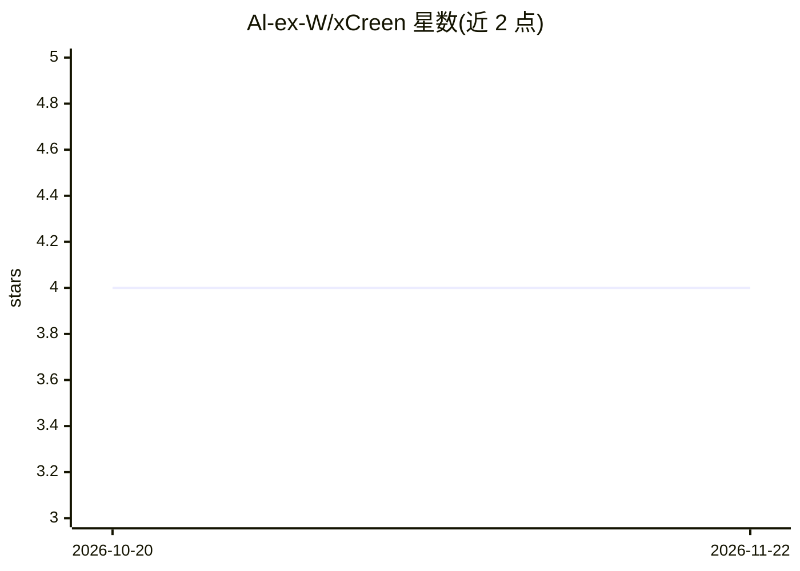

# Al-ex-W/xCreen

⭐ 4 · Python · Apache-2.0 · 推送 2026-10-20 · [GitHub](https://github.com/Al-ex-W/xCreen) · [官网](https://al-ex-w.github.io/xCreen/) · 个人维护

**macOS 屏幕记忆工具：本地 OCR 摘要写入 Obsidian 日记**

面向在 macOS 上运行 Hermes Agent 并使用 Obsidian 记笔记的用户：菜单栏应用对聚焦显示器截图并本地执行 Apple Vision OCR（去重、每 10 秒存档），服务器端每 30 张截图打包发送到 Hermes 会话，由模型按笔记库自身约定在当日 Daily note 写入要点与 wikilinks，原始证据仅本地保留 7 天。提供 tray/Spotlight/CLI 问答入口，带 Integrity 一键停止截屏开关。不含模型与 API key，需自备 Hermes 安装。

## 筛选速览

| 维度 | 判定 | 备注 |
|---|---|---|
| AI 角色 | `ai-native` | 本体是模型或模型工具 |
| 许可风险 | `permissive` | Apache-2.0 |
| 部署形态 | `None` |  |
| 模型依赖 | — | README 未给出锁定关系 |
| 硬件要求 | — | 无带数字的原话,不猜 |
| 安装摩擦 | `low` | 无编译、无系统依赖或容器化 |
| 成熟度 | — | 结构信号不足 |

## 能力要点

- 本地 Apple Vision OCR 截屏捕获，≥90% 相似文本去重
- 每 30 张截图合并为一个持久 Hermes 会话批量摘要
- 仅向 Obsidian vault 写入短要点，证据与哈希留在私有日志
- Integrity 开关默认开启，用户独占控制截屏与 OCR

## 适用场景

- 回顾今天屏幕上看到的报错或信息
- 自动把工作中的决定与截止日期记入 Obsidian 日记
- 在本地保留屏幕证据、7 天自动过期

## 场景标签

`知识库管理` `OCR` · 领域:知识与检索

## 证据(README 行号)

> L3: **xCreen reads your screen with local OCR and has your Hermes Agent write short takeaways into your Obsidian daily n
> L21: - **7-day local retention, any model.** Raw evidence is deleted after seven days. You can pick any model your Herme
> L44: - **A working Hermes Agent install is required.** xCreen does not include a model or keep API keys. It uses your He

## 星数曲线

2026-10-20 4 → 2026-11-22 4（+0）

---
*卡片 v1 · prompt 1.4 · 生成 2026-11-21 · 置信度 high · 依据 README sha `237ad8094f45` · [字段定义](../../DATASET.md)*
