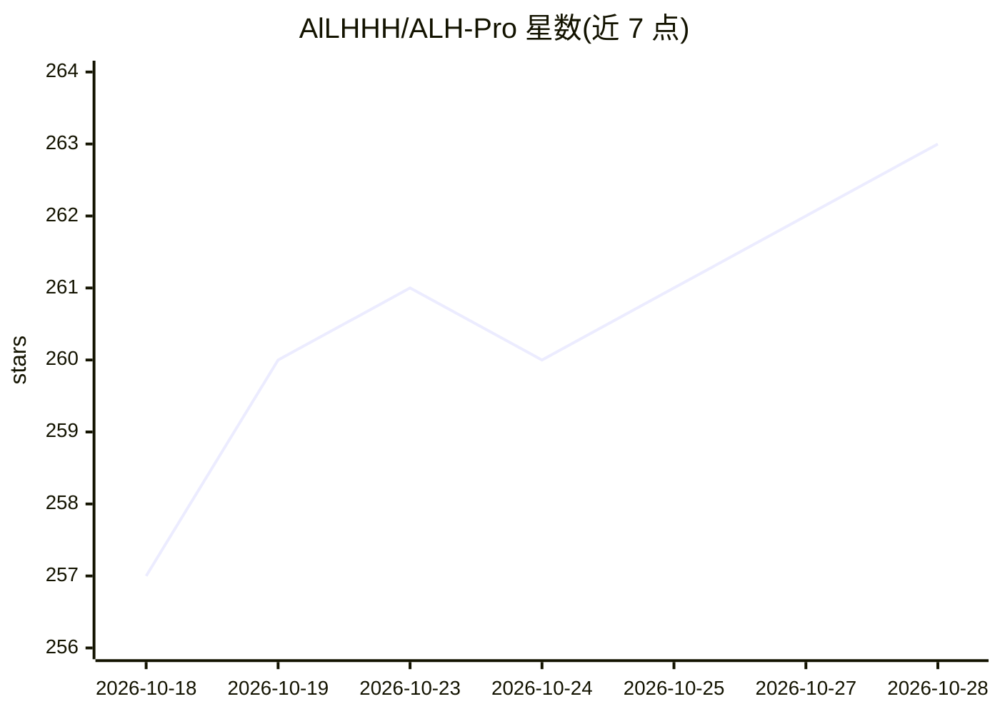

# AlLHHH/ALH-Pro

⭐ 263 · C# · MIT · 推送 2026-10-27 · [GitHub](https://github.com/AlLHHH/ALH-Pro) · [官网](https://alhpro.cn/) · 个人维护 · 中文 README

**本地运行的 AI 图片/视频/音频增强工具，全部处理在本机完成**

面向普通用户的 Windows 桌面工具，功能覆盖图片超分（waifu2x/Real-ESRGAN）、AI 抠图（U²-Net/ISNet/BiRefNet，CPU 运行）、视频超分/补帧（Real-ESRGAN/Real-CUGAN/RIFE）、去重、音频分离与增强（Demucs/LavaSR），基于 ncnn 与 ONNX Runtime 引擎。所有处理在本机完成，不上传数据，安装后离线可用。无独显时自动降级 CPU，按显卡型号提供兼容性矩阵。本体 MIT 许可，第三方引擎许可另列；FFmpeg 以独立子进程调用。仅支持 Windows 10/11 x64。

## 筛选速览

| 维度 | 判定 | 备注 |
|---|---|---|
| AI 角色 | `ai-native` | 本体是模型或模型工具 |
| 许可风险 | `permissive` | MIT |
| 部署形态 | `None` |  |
| 模型依赖 | — | README 未给出锁定关系 |
| 硬件要求 | — | 无带数字的原话,不猜 |
| 安装摩擦 | `medium` | 含编译或系统依赖之一 |
| 成熟度 | — | 结构信号不足 |

## 能力要点

- 图片超分、AI 抠图、视频超分/补帧/去重、音频分离/增强，全部本地处理
- 无 GPU 自动降级 CPU，按显卡型号给出兼容性矩阵（含 RTX 50 系适配）
- 安装包约 900MB（完整版 2.4GB 含全部模型），装完离线可用
- 本体 MIT 许可，支持商用与再分发

## 适用场景

- 给动漫图片/视频做超分、去重与补帧处理
- 一键 AI 抠图移除背景
- 提取或去除歌曲人声、增强老录音
- 在无网络环境下离线处理素材

## 场景标签

`图像视频处理` · 领域:感知与多模态

## 证据(README 行号)

> L5: 图片/视频/音频 AI 增强工具(本地运行),支持:图片超分、AI 抠图、视频超分、视频补帧、视频去重、音频分离/增强/真超分。
> L7: **所有处理在本机完成,不上传、不收集任何用户数据。** 全程中文界面。
> L12: - 系统要求:Windows 10/11 x64(无 GPU 也可用,自动降级 CPU)

## 星数曲线

2026-10-18 257 → 2026-10-28 263（+6）

---
*卡片 v1 · prompt 1.4 · 生成 2026-10-22 · 置信度 high · 依据 README sha `8975f67a6dcd` · [字段定义](../../DATASET.md)*
