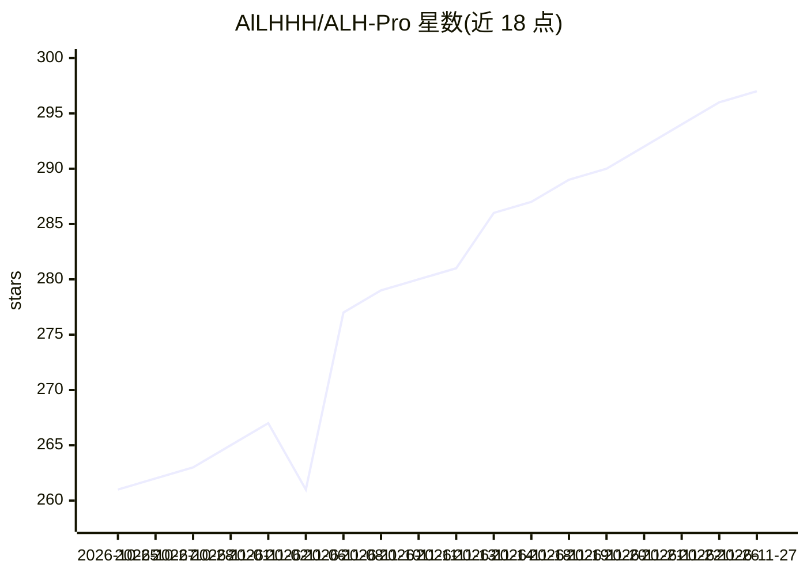

# AlLHHH/ALH-Pro

⭐ 297 · C# · GPL-3.0 · 推送 2026-11-26 · [GitHub](https://github.com/AlLHHH/ALH-Pro) · [官网](https://alhpro.cn/) · 个人维护 · 中文 README

**本地运行的图片/视频/音频 AI 增强桌面工具**

Windows 桌面应用，将多种开源引擎封装为本地处理流水线：图片超分（waifu2x/Real-ESRGAN）、AI 抠图（U²-Net/ISNet/BiRefNet）、视频超分（Real-CUGAN）、RIFE 补帧、重复帧去除，以及音频升采样/人声分离（Demucs）/增强。全部处理在本机完成，不上传数据；启动时自动检测 GPU 并在不兼容时降级 DirectML 或 CPU，无独立显卡也可运行。普通用户下载安装包即可，开发者可用 .NET 8 SDK 从源码构建。

## 筛选速览

| 维度 | 判定 | 备注 |
|---|---|---|
| AI 角色 | `ai-native` | 本体是模型或模型工具 |
| 许可风险 | `viral` | GPL-3.0 |
| 部署形态 | `None` |  |
| 模型依赖 | — | README 未给出锁定关系 |
| 硬件要求 | — | 无带数字的原话,不猜 |
| 安装摩擦 | `medium` | 含编译或系统依赖之一 |
| 成熟度 | — | 结构信号不足 |

## 能力要点

- 集成 waifu2x、Real-ESRGAN、RIFE、Demucs 等多个开源引擎
- 全部处理在本机完成，不上传、不收集用户数据
- 启动时自动检测 GPU，不兼容时自动降级 DirectML/CPU
- 提供显卡兼容性矩阵与安全渲染（显存/内存/CPU 墙自适应）

## 适用场景

- 批量放大动漫插画或照片并降噪
- 一键去除图片背景并调整边缘
- 给动漫视频去重帧后补帧提升流畅度
- 从歌曲中分离人声与伴奏或提升录音采样率

## 场景标签

`图像视频处理` · 领域:感知与多模态

## 证据(README 行号)

> L5: 图片/视频/音频 AI 增强工具(本地运行),支持:图片超分、AI 抠图、视频超分、视频补帧、视频去重、音频分离/增强/真超分。
> L11: - 引擎:waifu2x / Real-ESRGAN / RIFE(基于 nihui/ncnn)、U²-Net / ISNet / BiRefNet(基于 ONNX Runtime)、FFmpeg
> L76: 1. 打开 Releases 页面 → 点 **Assets** 里的**最新版安装包**下载(约 900MB);

## 星数曲线

2026-10-25 261 → 2026-11-27 297（+36）

---
*卡片 v1 · prompt 1.4 · 生成 2026-11-27 · 置信度 high · 依据 README sha `17fefae1792f` · [字段定义](../../DATASET.md)*
