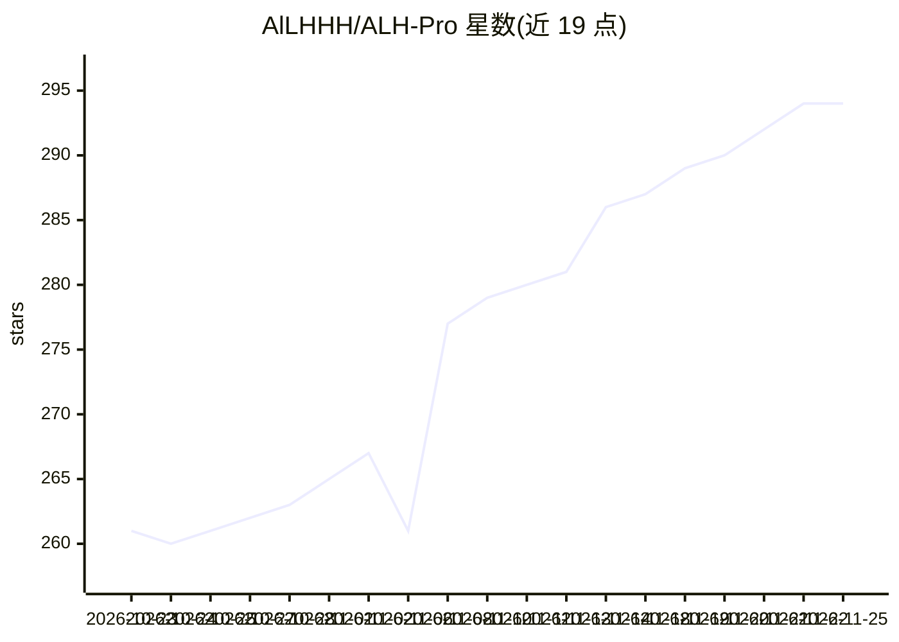

# AlLHHH/ALH-Pro

⭐ 294 · C# · MIT · 推送 2026-11-16 · [GitHub](https://github.com/AlLHHH/ALH-Pro) · [官网](https://alhpro.cn/) · 个人维护 · 中文 README

**本地运行的图片/视频/音频 AI 增强桌面工具**

面向普通用户与内容创作者的本地媒体增强工具，功能覆盖图片超分（waifu2x/Real-ESRGAN）、AI 抠图（U²-Net/ISNet/BiRefNet）、视频超分与补帧（Real-CUGAN/RIFE）、动漫去重帧、音频升采样/分离（Demucs）。所有处理在本机完成，不上传数据，全程中文界面。普通用户从 Releases 下载约 900MB 安装包即可使用；开发者需自备 engines 目录并以 .NET 8 SDK 构建。仅支持 Windows 10/11 x64，无 GPU 时自动降级 CPU。

## 筛选速览

| 维度 | 判定 | 备注 |
|---|---|---|
| AI 角色 | `ai-native` | 本体是模型或模型工具 |
| 许可风险 | `permissive` | MIT |
| 部署形态 | `None` |  |
| 模型依赖 | — | README 未给出锁定关系 |
| 硬件要求 | — | 无带数字的原话,不猜 |
| 安装摩擦 | `medium` | 含编译或系统依赖之一 |
| 成熟度 | — | 结构信号不足 |

## 能力要点

- 图片超分、AI 抠图、视频超分/补帧、去重帧、音频分离/增强一站式
- 所有处理本地完成，不上传、不收集用户数据，离线可用
- 启动时自动检测 GPU 并按显卡兼容性自动选择引擎或降级
- 提供完整版安装包（约 2.4GB，含全部引擎与模型）

## 适用场景

- 批量放大与降噪动漫插画或真实照片
- 给动漫视频去除重复帧后再补帧提升流畅度
- 本地离线分离人声/伴奏或提升老录音采样率
- 在不联网、不传素材的前提下做 AI 抠图

## 场景标签

`图像视频处理` · 领域:感知与多模态

## 证据(README 行号)

> L5: 图片/视频/音频 AI 增强工具(本地运行),支持:图片超分、AI 抠图、视频超分、视频补帧、视频去重、音频分离/增强/真超分。
> L11: - 引擎:waifu2x / Real-ESRGAN / RIFE(基于 nihui/ncnn)、U²-Net / ISNet / BiRefNet(基于 ONNX Runtime)、FFmpeg
> L76: 1. 打开 Releases 页面 → 点 **Assets** 里的**最新版安装包**下载(约 900MB);

## 星数曲线

2026-10-23 261 → 2026-11-25 294（+33）

---
*卡片 v1 · prompt 1.4 · 生成 2026-11-25 · 置信度 high · 依据 README sha `4aae67a86bbd` · [字段定义](../../DATASET.md)*
