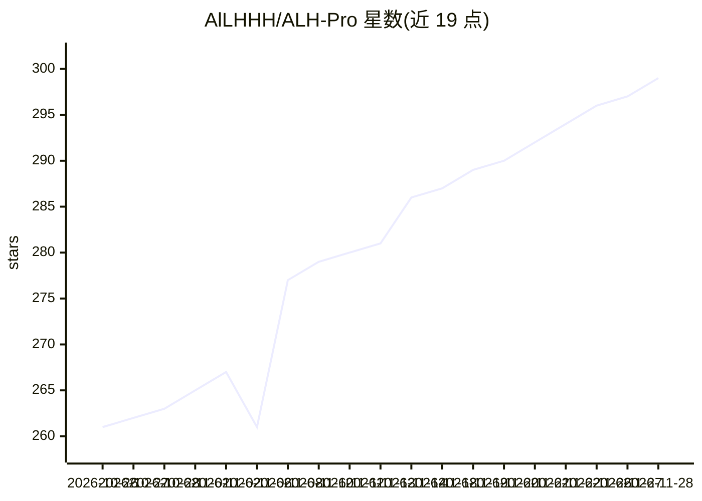

# AlLHHH/ALH-Pro

⭐ 299 · C# · GPL-3.0 · 推送 2026-11-27 · [GitHub](https://github.com/AlLHHH/ALH-Pro) · [官网](https://alhpro.cn/) · 个人维护 · 中文 README

**本地离线运行的图片/视频/音频 AI 增强工具**

面向本地素材处理的桌面工具（v1.4.11，Windows 安装包），功能覆盖图片超分（waifu2x/Real-ESRGAN，1x–4x）、AI 抠图（U²-Net/ISNet/BiRefNet 等 6 款模型）、视频超分与补帧（Real-CUGAN/Real-RIFE）、针对动画作画节奏的帧级去重，以及基于 Demucs 的音频分离与增强。所有处理在本机完成，不上传文件、断网可用。按显存/内存自动定档，显卡不兼容时自动切 DirectML 或 CPU。提供标准版与含全部引擎模型的完整版安装包，也可从源码构建，但引擎与模型需自行获取。

## 筛选速览

| 维度 | 判定 | 备注 |
|---|---|---|
| AI 角色 | `ai-native` | 本体是模型或模型工具 |
| 许可风险 | `viral` | GPL-3.0 |
| 部署形态 | `desktop` | 安装包/桌面程序 |
| 模型依赖 | — | README 未给出锁定关系 |
| 硬件要求 | — | 无带数字的原话,不猜 |
| 安装摩擦 | `medium` | 含编译或系统依赖之一 |
| 成熟度 | — | 结构信号不足 |

## 能力要点

- 图片超分、AI 抠图、视频超分、补帧、音频分离与增强全部本地离线完成
- 动画帧级去重：删重复保持帧后按内容帧率补帧再输出
- 按硬件自动定档，引擎不兼容自动切 DirectML，无独显降级 CPU
- 提供标准版/完整版安装包与 .NET 8 源码构建路径

## 适用场景

- 批量放大动漫插画或实拍照片到 4 倍
- 给动画素材去除重复帧后再补帧提升流畅度
- 提取视频中的人声或伴奏并做降噪增强
- 离线环境下处理需要保密的图片视频素材

## 场景标签

`图像视频处理` · 领域:感知与多模态

## 证据(README 行号)

> L3: 图片、视频、音频的本地增强工具。所有处理在本机完成,不上传文件、不收集数据,断网可用。
> L13: 功能包括图片超分、AI 抠图、视频超分、视频补帧、视频去除重复帧、音频分离与增强。
> L36: - 六款模型:U²-Net(通用、轻量)、ISNet(精细边缘、动漫)、BiRefNet(高精度,完整版附带)

## 星数曲线

2026-10-26 261 → 2026-11-28 299（+38）

---
*卡片 v1 · prompt 1.4 · 生成 2026-11-28 · 置信度 high · 依据 README sha `3caeaf417142` · [字段定义](../../DATASET.md)*
