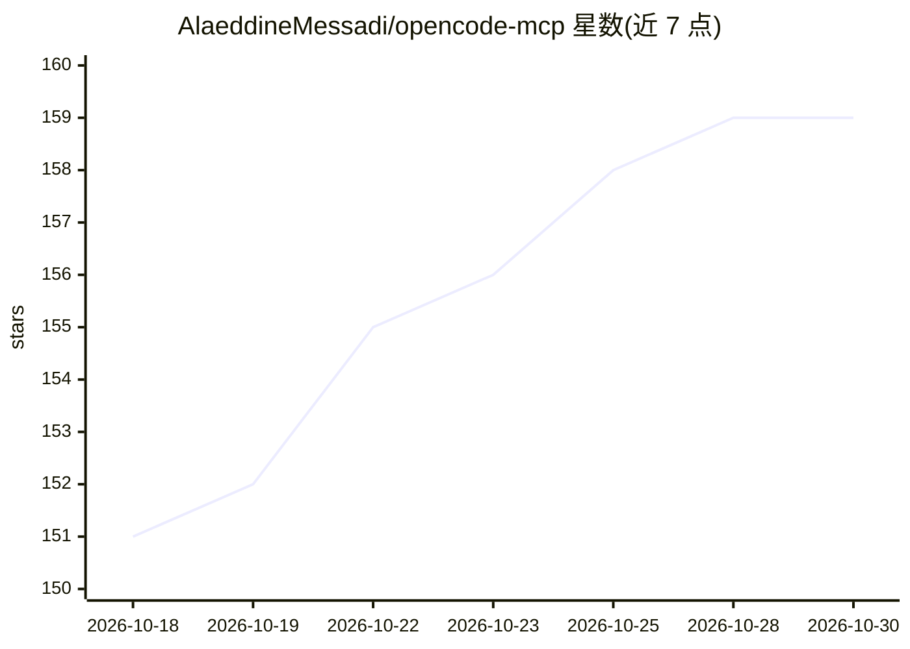

# AlaeddineMessadi/opencode-mcp

⭐ 159 · TypeScript · MIT · 推送 2026-10-29 · [GitHub](https://github.com/AlaeddineMessadi/opencode-mcp) · [官网](https://www.npmjs.com/package/opencode-mcp) · 个人维护

**把编码任务委托给 OpenCode 的 MCP 服务器（70 工具/10 资源/5 提示）**

opencode-mcp 将 Claude Desktop、Claude Code、Cursor、VS Code、Windsurf 等 MCP 客户端连接到 OpenCode 的 headless API：通过 opencode_ask/opencode_run/opencode_fire 等工具实现提问、实现功能、后台任务监控、响应权限与问题、跨项目审查变更。支持多项目（绝对路径跨平台保留）、可选本地自动启动服务器、结构化输出与工具集裁剪。要求 Node.js 22+，OpenCode 服务器需已运行（或设置 AUTO_SERVE），异步任务通过轮询获取状态。

## 筛选速览

| 维度 | 判定 | 备注 |
|---|---|---|
| AI 角色 | `ai-ecosystem` | LLM/agent 周边工具 |
| 许可风险 | `permissive` | MIT |
| 部署形态 | `library` | 以包/库形式分发 |
| 模型依赖 | — | README 未给出锁定关系 |
| 硬件要求 | — | 无带数字的原话,不猜 |
| 安装摩擦 | `low` | 无编译、无系统依赖或容器化 |
| 成熟度 | — | 结构信号不足 |

## 能力要点

- 提供 70 个工具、10 个资源、5 个提示，覆盖设置/提问/后台任务/审查等工作流
- 支持多项目：directory 参数跨 POSIX/Windows/UNC 路径
- 异步任务区分 accepted/running/input_required 等 7 种状态，通过轮询检索
- 通过环境变量配置服务器端点、默认 provider/model 与工具集档位

## 适用场景

- 在 Claude Code 或 Cursor 中把编码任务委托给 OpenCode 执行
- 并行跟踪多个项目的后台编码任务并审查变更
- 通过 MCP 客户端以问答形式快速咨询 OpenCode

## 场景标签

`编码 Agent` `代码审查` · 领域:编码与开发

## 证据(README 行号)

> L7: **Delegate coding work to OpenCode from your MCP client.**
> L9: opencode-mcp connects Claude, Cursor, VS Code, and other MCP clients to OpenCode's headless API. Ask questions, impl

## 星数曲线

2026-10-18 151 → 2026-10-30 159（+8）

---
*卡片 v1 · prompt 1.4 · 生成 2026-10-22 · 置信度 high · 依据 README sha `af738a062ba7` · [字段定义](../../DATASET.md)*
