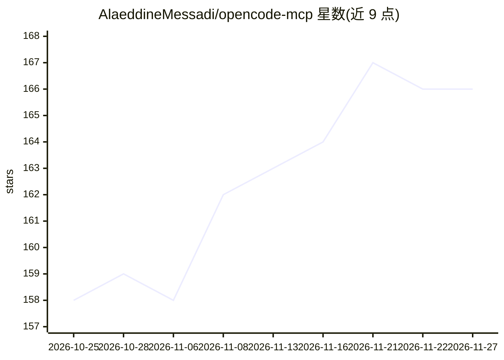

# AlaeddineMessadi/opencode-mcp

⭐ 166 · TypeScript · MIT · 推送 2026-10-29 · [GitHub](https://github.com/AlaeddineMessadi/opencode-mcp) · [官网](https://www.npmjs.com/package/opencode-mcp) · 个人维护

**将 OpenCode 无头 API 接入 MCP 客户端的桥接服务器**

opencode-mcp 是一个 MCP server，把 Claude、Cursor、VS Code 等 MCP 客户端连接到 OpenCode 的无头 API：提供 70 个工具、10 个资源、5 个提示词，用于提问、实现功能、后台任务监控、回应权限与问题、审查跨项目变更。任务状态分为 accepted/running/input_required/completed/failed/cancelled/unknown，通过轮询获取；默认需预先运行 OpenCode 服务器，自动启动仅限本地回环地址，可通过环境变量配置端点、认证与默认 provider/model。要求 Node.js 22+ 与 OpenCode 1.x。

## 筛选速览

| 维度 | 判定 | 备注 |
|---|---|---|
| AI 角色 | `ai-ecosystem` | LLM/agent 周边工具 |
| 许可风险 | `permissive` | MIT |
| 部署形态 | `library` | 以包/库形式分发 |
| 模型依赖 | — | README 未给出锁定关系 |
| 硬件要求 | — | 无带数字的原话,不猜 |
| 安装摩擦 | `low` | 无编译、无系统依赖或容器化 |
| 成熟度 | — | 结构信号不足 |

## 能力要点

- 70 个工具覆盖设置、提问、后台任务、权限回应与变更审查
- 后台任务支持 accepted/running/input_required 等七种状态与轮询查询
- 多项目支持：directory 接受 POSIX/Windows/UNC 绝对路径
- 兼容 MCP Tasks 扩展，现代客户端可用于 opencode_run

## 适用场景

- 在 Claude Code 或 Cursor 中委托 OpenCode 实现功能并运行测试
- 后台批量发起编码任务并轮询进度、审查结果
- 同时管理多个项目目录的编码任务

## 场景标签

`编码 Agent` · 领域:编码与开发

## 证据(README 行号)

> L7: **Delegate coding work to OpenCode from your MCP client.**
> L9: opencode-mcp connects Claude, Cursor, VS Code, and other MCP clients to OpenCode's headless API. Ask questions, impl
> L40: Client-specific configuration includes VS Code, Windsurf, Continue, Zed, and Amazon Q. To test unreleased changes, 

## 星数曲线

2026-10-25 158 → 2026-11-27 166（+8）

---
*卡片 v1 · prompt 1.4 · 生成 2026-11-27 · 置信度 high · 依据 README sha `546063af162c` · [字段定义](../../DATASET.md)*
