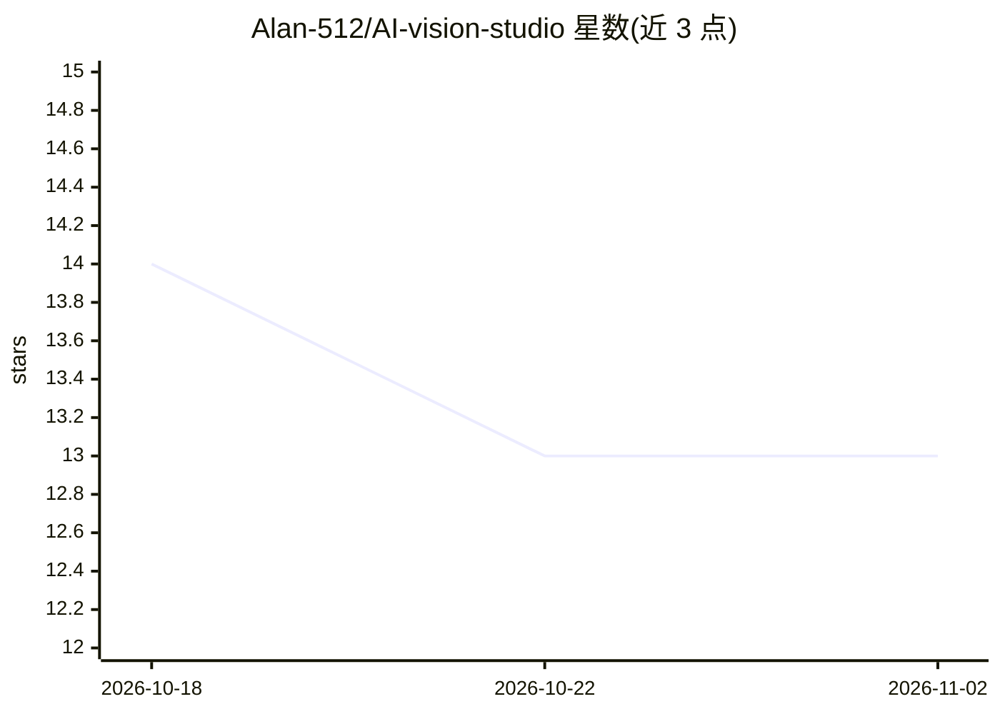

# Alan-512/AI-vision-studio

⭐ 13 · TypeScript · MIT · 推送 2026-04-17 · [GitHub](https://github.com/Alan-512/AI-vision-studio) · [官网](https://ai-vision-studio.pages.dev) · 个人维护 · 中文 README

**浏览器端 AI 图像/视频生成工坊，基于 Gemini 与 Veo**

基于 React 18 + TypeScript 的浏览器优先 AI 创意影像应用，接入 Google Gemini 图像模型（gemini-3.1-flash-image-preview、gemini-3-pro-image-preview）与 Veo 3.1 视频模型，提供参数化工作台与聊天 Agent 助手两种工作流。支持最多 14 张参考图控制角色/结构/风格、Google Search grounding、蒙版局部重绘、视频延展与首尾帧控制。采用 BYOK 模式，API key 存于浏览器本地，可无后端静态部署，另附 Cloudflare Pages 代理函数。面向持有 Google AI Studio API key 的创作者，需 Node.js 18+ 自行构建运行。

## 筛选速览

| 维度 | 判定 | 备注 |
|---|---|---|
| AI 角色 | `ai-native` | 本体是模型或模型工具 |
| 许可风险 | `permissive` | MIT |
| 部署形态 | `library` | 以包/库形式分发 |
| 模型依赖 | — | README 未给出锁定关系 |
| 硬件要求 | — | 无带数字的原话,不猜 |
| 安装摩擦 | `low` | 无编译、无系统依赖或容器化 |
| 成熟度 | — | 结构信号不足 |

## 能力要点

- 接入 Gemini 3.1 图像模型与 Veo 3.1 视频模型
- 最多 14 张参考图控制角色/结构/风格，支持 Google Search grounding
- Agent 助手可自主操作工作台界面完成多步生成与修订
- BYOK 模式，key 存浏览器本地，可无后端静态部署

## 适用场景

- 用参数面板精确控制图像生成的比例/风格/分辨率
- 通过自然语言让 Agent 助手编排图像生成与多轮修订
- 用参考图保持角色一致性并生成/延展视频

## 场景标签

`图像生成` `视频生成` · 领域:内容生成

## 证据(README 行号)

> L5: Browser-first AI image and video studio powered by **Google Gemini** and **Veo**.
> L18: - **Powered by Gemini 3.1**: Support for `gemini-3.1-flash-image-preview` (Nano Banana 2) and `gemini-3-pro-image-p
> L25: - **Veo Model Integration**: Generate high-quality videos using Google's latest `Veo` model (`veo-3.1`).

## 星数曲线

2026-10-18 14 → 2026-11-02 13（-1）

---
*卡片 v1 · prompt 1.4 · 生成 2026-10-31 · 置信度 high · 依据 README sha `3fbae3a1477f` · [字段定义](../../DATASET.md)*
