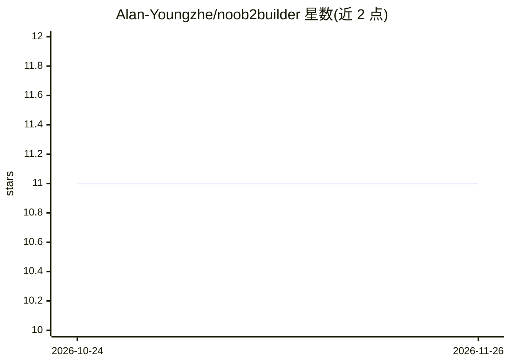

# Alan-Youngzhe/noob2builder

⭐ 11 · Python · NOASSERTION · 推送 2026-09-16 · [GitHub](https://github.com/Alan-Youngzhe/noob2builder) · 个人维护 · 中文 README

**纯小白在 Claude Code 里由 Agent 带学的 AI 构建课程**

以 Claude Code Skill 形式发行的交互式教程：安装后成为 /nb 一个命令，Agent 导师在主对话中展示 14 门选修课（网络基础、LLM/Agent 原理、Git、前端、后端、Agent 构建实验室等），带学生操作真实文件、运行真实命令，学习存档保存在 ~/.noob2builder/me.json 以记录完成证据并支持跨会话续课。定位从零基础到发布第一个可验收作品。课程 Markdown 采用 CC BY-NC-SA 4.0 许可，当前为 Alpha (v0.8.0)。

## 筛选速览

| 维度 | 判定 | 备注 |
|---|---|---|
| AI 角色 | `ai-knowledge` | 知识聚合/清单类 |
| 许可风险 | `none` | NOASSERTION |
| 部署形态 | `None` |  |
| 模型依赖 | — | README 未给出锁定关系 |
| 硬件要求 | — | 无带数字的原话,不猜 |
| 安装摩擦 | `low` | 无编译、无系统依赖或容器化 |
| 成熟度 | `idea` | |

## 能力要点

- 14 门选修课以稳定 ID 组织，无必修顺序
- 本地学习存档记录节点证据、未验证项与下一步
- 提供 macOS/Linux 与 Windows 一行安装脚本，不覆盖本地修改
- 校友墙机制：提交 PR 留里程碑证据与复盘

## 适用场景

- 零基础学习者在对话中从电脑基础学到发布第一个作品
- 从 vibe coding 进阶到带测试与验证的 agentic engineering
- 换电脑时带上存档文件继续上课进度

## 场景标签

`教程课程` · 领域:学习与行业

## 证据(README 行号)

> L9: 一所由 Agent 亲自带学的学校。不是文档合集，而是导师在主对话里讲清原理，带你操作真实文件、运行真实命令，直到你做出并发布第一个可验收的作品。
> L13: *An AI Builder school that runs inside Claude Code as a single `/nb` command: 14 elective courses, real files and r
> L26: ## 课程

## 星数曲线

2026-10-24 11 → 2026-11-26 11（+0）

---
*卡片 v1 · prompt 1.4 · 生成 2026-11-19 · 置信度 high · 依据 README sha `3be521610020` · [字段定义](../../DATASET.md)*
