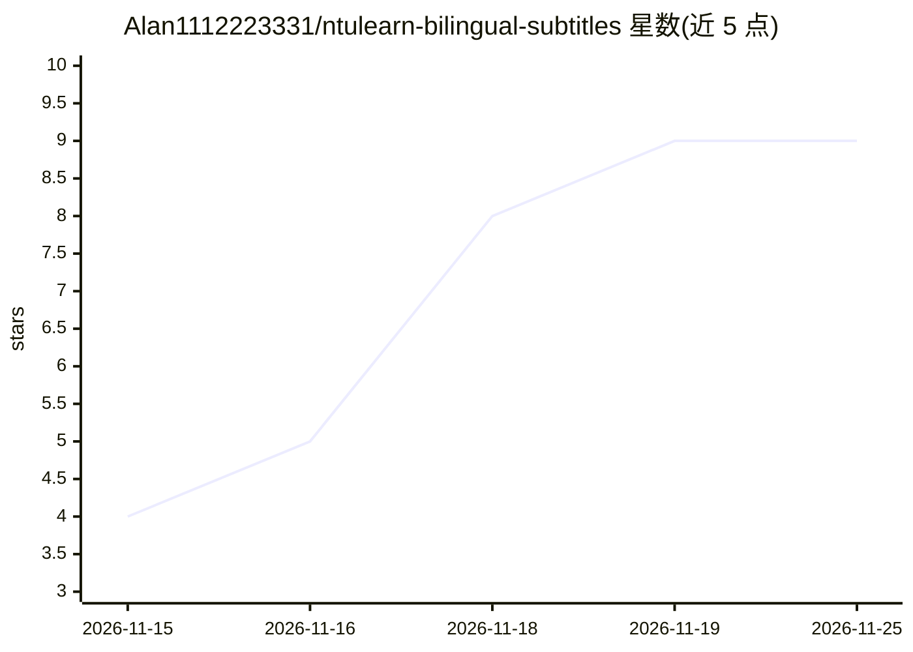

# Alan1112223331/ntulearn-bilingual-subtitles

⭐ 9 · JavaScript · MIT · 推送 2026-11-06 · [GitHub](https://github.com/Alan1112223331/ntulearn-bilingual-subtitles) · 个人维护 · 中文 README

**为 NTU 课程视频生成双语字幕、笔记与问答的浏览器扩展**

面向 NTULearn Media Gallery（Kaltura）课程视频的 Chrome 扩展：截获并整片拉取分段 WebVTT 字幕后预翻译，生成双语字幕；侧边栏提供逐段译文、按知识点组织的 AI 课堂笔记和结合课程内容的对话。提供两种翻译引擎：默认免配置的 Google 翻译基础模式，以及可接入 OpenAI/Anthropic/Gemini 格式接口或 ChatGPT 订阅登录的 AI 精准模式。译文与笔记按视频缓存在本地，支持导出 SRT/Markdown。默认匹配 Kaltura 与 ntu.edu.sg 域名，其他学校需修改 manifest 后自行适配。

## 筛选速览

| 维度 | 判定 | 备注 |
|---|---|---|
| AI 角色 | `ai-native` | 本体是模型或模型工具 |
| 许可风险 | `permissive` | MIT |
| 部署形态 | `None` |  |
| 模型依赖 | — | README 未给出锁定关系 |
| 硬件要求 | — | 无带数字的原话,不猜 |
| 安装摩擦 | `low` | 无编译、无系统依赖或容器化 |
| 成熟度 | — | 结构信号不足 |

## 能力要点

- 整片预翻译：截获 5 分钟分段 WebVTT 后主动拉取全部分段，结果按视频本地缓存
- 三种接口格式（OpenAI/Anthropic/Gemini）Base URL/Key/模型名均可自定义
- AI 课堂笔记按知识点组织，带时间戳、KaTeX 公式，可导出 Markdown/网页
- 翻译与笔记/问答可分别配置不同模型

## 适用场景

- 在 NTULearn 上看英文授课视频时显示双语字幕
- 为整节课生成知识点笔记和自测题
- 向 AI 提问课程内容并跳转到对应时间点
- 导出双语 SRT 或文稿离线复习

## 场景标签

`文档问答` `AI 写作` · 领域:内容生成

## 证据(README 行号)

> L5: **为 NTULearn Media Gallery（Kaltura）课程视频生成双语字幕，并在侧边栏提供逐段译文、AI 课堂笔记和课程问答**
> L22:  - **AI 精准模式（推荐）**：接入你自己的大模型，或直接登录 **ChatGPT 用订阅额度**（不需要 API Key），结合上下文、*课程背景* 和 *术语表* 翻译，提示词针对语音识别字幕（断句、识别错误）专门优化，

## 星数曲线

2026-11-15 4 → 2026-11-25 9（+5）

---
*卡片 v1 · prompt 1.4 · 生成 2026-11-20 · 置信度 high · 依据 README sha `ae8019500df8` · [字段定义](../../DATASET.md)*
