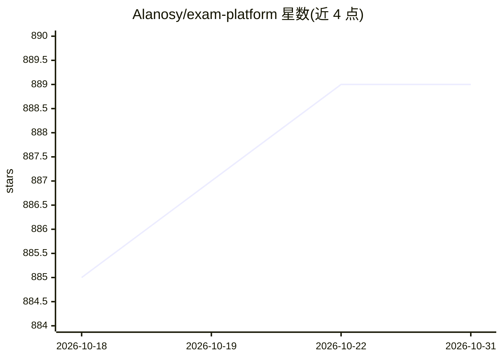

# Alanosy/exam-platform

⭐ 889 · Java · MIT · 推送 2026-10-22 · [GitHub](https://github.com/Alanosy/exam-platform) · [官网](https://doc.alan.org.cn) · 个人维护 · 中文 README

**面向学校/培训机构的开箱即用在线考试系统（微服务+Vue3）**

「砚考」是覆盖出题、组卷、考试、监考、阅卷、统计、发证、错题巩固全流程的在线考试系统，支持学生/教师/管理员三种角色。后端为基于 RuoYi-Cloud-Plus 的 Spring Cloud 微服务（10 个业务服务，Nacos/Dubbo/网关鉴权），前端为 Vue3 + TypeScript SPA。提供规则随机抽题、13 类行为防作弊（服务端判定强制交卷）、客观题自动判分、错题本与证书自动颁发。AI 部分（Python Agent 出题/阅卷/推荐/试卷分析）已完成实现但尚未与 Java 侧接线，当前 AI 阅卷返回「未接入」；项目自述仍在开发中。运行需 JDK 17/21、MySQL 8、Redis 7、Nacos 2.x、Node 18+。

## 筛选速览

| 维度 | 判定 | 备注 |
|---|---|---|
| AI 角色 | `ai-enhanced` | 去掉 AI 部分产品仍成立 |
| 许可风险 | `permissive` | MIT |
| 部署形态 | `None` |  |
| 模型依赖 | — | README 未给出锁定关系 |
| 硬件要求 | — | 无带数字的原话,不猜 |
| 安装摩擦 | `low` | 无编译、无系统依赖或容器化 |
| 成熟度 | `idea` | |

## 能力要点

- 出题→组卷→考试→监考→阅卷→统计→发证→错题巩固全流程闭环
- 13 类防作弊行为检测，达到上限由服务端判定强制交卷
- 10 个可独立部署的考试业务微服务（RuoYi-Cloud-Plus 架构）
- Python Agent 已实现出题、阅卷、推荐、试卷分析四类 AI 能力（接线中）

## 适用场景

- 学校或培训机构组织在线考试与自动判分
- 需要防作弊监控与监考留证的高利害考试
- 考生考后错题重练与证书自动颁发

## 场景标签

 · 领域:教育/在线考试系统

## 证据(README 行号)

> L17: 「砚考」是一款开箱即用的在线考试系统，覆盖 **出题 → 组卷 → 考试 → 监考 → 阅卷 → 统计 → 发证 → 错题巩固** 的完整闭环，支持学生、教师、管理员三种角色。
> L37: AI 能力正在接入中：Python Agent（`ruoyi-exam-agent`）已完成出题、阅卷、推荐、试卷分析四类能力，Java 侧网关与模型配置表已就绪，**接线工作进行中**，当前 AI 阅卷会返回「未接入」。
> L55: |AI服务|开发中：Java 网关与 AI 模型配置已就绪，Python Agent 已实现出题、阅卷、推荐、试卷分析四类能力，**但尚未与 Java 侧接线**，AI 阅卷目前返回「未接入」|

## 星数曲线

2026-10-18 885 → 2026-10-31 889（+4）

---
*卡片 v1 · prompt 1.4 · 生成 2026-10-21 · 置信度 high · 依据 README sha `e7b26643555a` · [字段定义](../../DATASET.md)*
