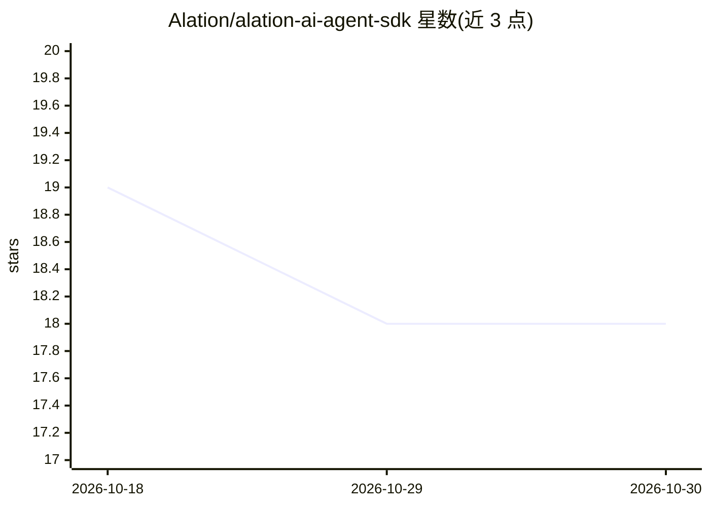

# Alation/alation-ai-agent-sdk

⭐ 18 · Python · Apache-2.0 · 推送 2026-10-26 · [GitHub](https://github.com/Alation/alation-ai-agent-sdk) · 组织维护

**让 AI agent 接入 Alation 数据目录的 Python SDK 与 MCP 服务器**

面向将 Alation 数据目录元数据接入 agent 工作流的开发者，提供三个组件：核心 SDK（处理认证、请求与响应解析）、LangChain 适配器、以及 MCP 服务器（支持 STDIO 与 HTTP 模式）。内置 8 个工具与 4 个 agent（目录上下文搜索、SQL 查询等），支持流式输出与 chat_id 会话关联。1.x 版本移除了 update_catalog_asset_metadata 等工具，并已弃用 Context Tool（2026 年 2 月移除）。另提供远程 MCP 服务器选项。使用需 Alation 实例访问权限与服务账号凭证，Python 3.10+。

## 筛选速览

| 维度 | 判定 | 备注 |
|---|---|---|
| AI 角色 | `ai-ecosystem` | LLM/agent 周边工具 |
| 许可风险 | `permissive` | Apache-2.0 |
| 部署形态 | `library` | 以包/库形式分发 |
| 模型依赖 | — | README 未给出锁定关系 |
| 硬件要求 | — | 无带数字的原话,不猜 |
| 安装摩擦 | `low` | 无编译、无系统依赖或容器化 |
| 成熟度 | — | 结构信号不足 |

## 能力要点

- 核心 SDK + LangChain 适配器 + MCP 服务器（STDIO/HTTP）三组件
- 8 个工具与 4 个 agent，含目录上下文搜索与 SQL 查询 agent
- 支持远程 MCP 服务器与动态工具列表
- 流式输出与 chat_id 会话关联

## 适用场景

- 让 AI agent 用自然语言检索数据目录元数据
- 在 Claude Desktop 或代码编辑器中通过 MCP 使用 Alation 数据
- 基于 LangChain 构建数据目录问答与查询 agent

## 场景标签

`数据分析` · 领域:效率与自动化

## 证据(README 行号)

> L3: The Alation AI Agent SDK enables AI agents to access and leverage metadata from the Alation Data Catalog.
> L19: - **MCP Integration** - Server implementation for Model Context Protocol
> L20: - **LangChain Integration** - Adapters for the LangChain framework

## 星数曲线

2026-10-18 19 → 2026-10-30 18（-1）

---
*卡片 v1 · prompt 1.4 · 生成 2026-10-29 · 置信度 high · 依据 README sha `ee857ba8efd1` · [字段定义](../../DATASET.md)*
