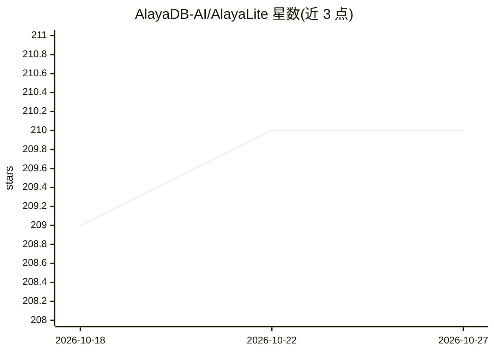

# AlayaDB-AI/AlayaLite

⭐ 210 · C++ · AGPL-3.0 · 推送 2026-07-22 · [GitHub](https://github.com/AlayaDB-AI/AlayaLite) · [官网](http://www.alayadb.tech/) · 组织维护

**面向所有人的轻量级 Python 向量数据库，含内存与磁盘双索引路径**

以 Python 包形式提供的向量数据库：一条包内提供两条索引路径——基于图 + RaBitQ 的内存索引用于低延迟检索，LASER 磁盘量化图索引处理超 RAM 的十亿级数据（热数据驻留 SSD）。Collection 支持带文档 ID、元数据过滤的混合检索；多线程由 C++20 协程优化。通过 pip/uv 安装，LASER 为可选 extra 且有平台差异（Linux 需 libaio，macOS 需 libomp，Windows 需 VS2022 构建环境）；v1 中 LASER 仅支持 float32、raw_dim≥128、L2 度量。README 含与 DiskANN/Qdrant 等系统的基准对比。

## 筛选速览

| 维度 | 判定 | 备注 |
|---|---|---|
| AI 角色 | `ai-ecosystem` | LLM/agent 周边工具 |
| 许可风险 | `viral` | AGPL-3.0 |
| 部署形态 | `library` | 以包/库形式分发 |
| 模型依赖 | — | README 未给出锁定关系 |
| 硬件要求 | — | 无带数字的原话,不猜 |
| 安装摩擦 | `low` | 无编译、无系统依赖或容器化 |
| 成熟度 | — | 结构信号不足 |

## 能力要点

- 内存图 + RaBitQ 索引与 LASER 磁盘量化图索引共存于一个包
- Collection 混合检索：ANN 结果附带文档 ID 与元数据过滤
- C++20 协程优化的多线程弹性扩展
- 量化方法、度量与数据类型可自定义

## 适用场景

- 在 Python 应用中做低延迟向量近邻检索
- 数据集超出 RAM 时用 LASER 在 SSD 上检索十亿级向量
- 需要元数据过滤的混合检索场景（如文档库）

## 场景标签

`向量数据库` · 领域:知识与检索

## 证据(README 行号)

> L19: - **Two index paths in one package**: an in-memory graph + RaBitQ path for low-latency
> L34: pip install alayalite             # with pip
> L55: collection = client.create_collection("docs", indexed_fields=["category"])

## 星数曲线

2026-10-18 209 → 2026-10-27 210（+1）

---
*卡片 v1 · prompt 1.4 · 生成 2026-10-22 · 置信度 high · 依据 README sha `6a0b900681d9` · [字段定义](../../DATASET.md)*
