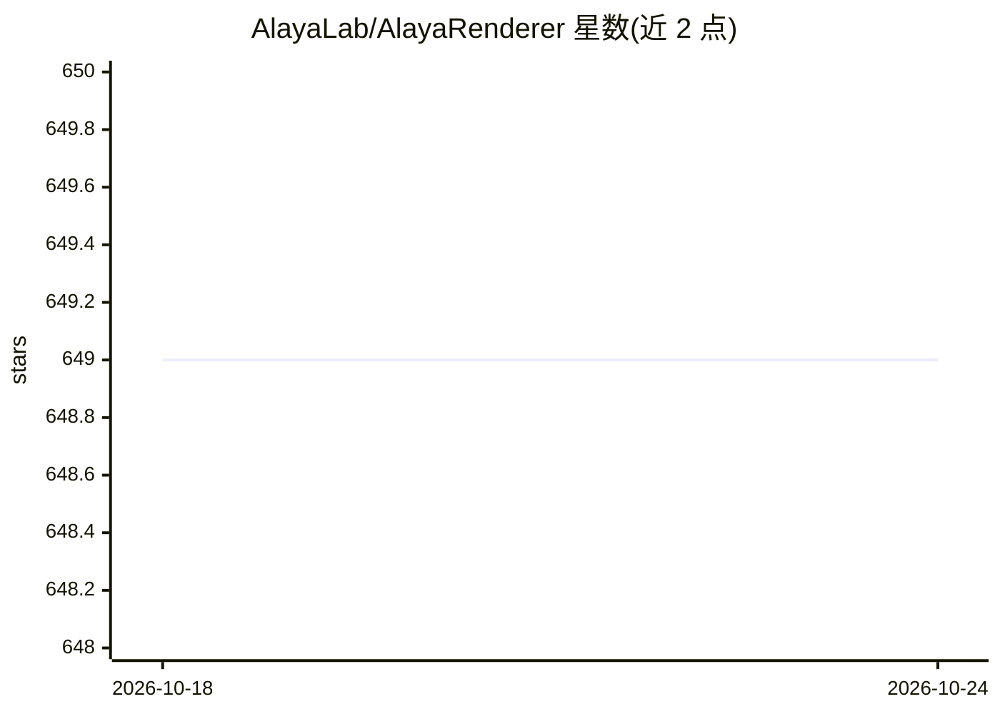

# AlayaLab/AlayaRenderer

⭐ 649 · Python · Apache-2.0 · 推送 2026-05-05 · [GitHub](https://github.com/AlayaLab/AlayaRenderer) · [官网](https://alaya-studio.github.io/renderer/) · 组织维护 · 中文 README

**面向游戏与虚拟世界的数据集与生成式渲染框架（逆向渲染+游戏编辑）**

发布于 arXiv 的数据集加模型框架项目：从两款 AAA 游戏（Cyberpunk 2077、黑神话：悟空）提取 400 万+帧、720p/30FPS、六通道同步（RGB+albedo/normal/depth/metallic/roughness）数据，并基于视频扩散模型微调两个模型——Inverse Renderer（基于 Cosmos-Transfer1-DiffusionRenderer 7B，将 RGB 视频分解为 G-buffer）与 Game Editing（基于 Wan2.1 1.3B，由 G-buffer+文本生成可控光照与风格的 RGB 视频），另提出基于 VLM 的免参考评测协议。仓库含两模型推理代码，权重托管于 HuggingFace；数据集与数据处理工具标注为 TODO 未发布。

## 筛选速览

| 维度 | 判定 | 备注 |
|---|---|---|
| AI 角色 | `ai-native` | 本体是模型或模型工具 |
| 许可风险 | `permissive` | Apache-2.0 |
| 部署形态 | `None` |  |
| 模型依赖 | — | README 未给出锁定关系 |
| 硬件要求 | — | 无带数字的原话,不猜 |
| 安装摩擦 | `low` | 无编译、无系统依赖或容器化 |
| 成熟度 | — | 结构信号不足 |

## 能力要点

- 400 万+帧、六通道同步的 AAA 游戏渲染数据集（40 小时，平均 8 分钟长序列）
- Inverse Renderer：RGB 视频分解为 albedo/normal/depth/roughness/metallic G-buffer
- Game Editing：G-buffer+文本合成可控光照与风格的照片级 RGB 视频
- 基于 VLM 的免参考材质预测评测协议

## 适用场景

- 游戏/虚拟世界研究中的逆向渲染与神经渲染实验
- 利用游戏数据训练与评测扩散渲染模型
- 通过 G-buffer 与文本提示进行场景风格化编辑

## 场景标签

`视频生成` · 领域:内容生成

## 证据(README 行号)

> L23: **TL;DR** We present a large-scale dataset and framework for high-quality inverse and forward rendering of videos u
> L25: - **Inverse Renderer** (RGB &rarr; G-buffers): Fine-tuned from Cosmos-Transfer1-DiffusionRenderer to decompose RGB 
> L26: - **Game Editing** (G-buffers + Text &rarr; Stylized RGB): Fine-tuned from Wan2.1 1.3B (via DiffSynth-Studio) to sy

## 星数曲线

2026-10-18 649 → 2026-10-24 649（+0）

---
*卡片 v1 · prompt 1.4 · 生成 2026-10-21 · 置信度 high · 依据 README sha `46e5d46a9b0d` · [字段定义](../../DATASET.md)*
