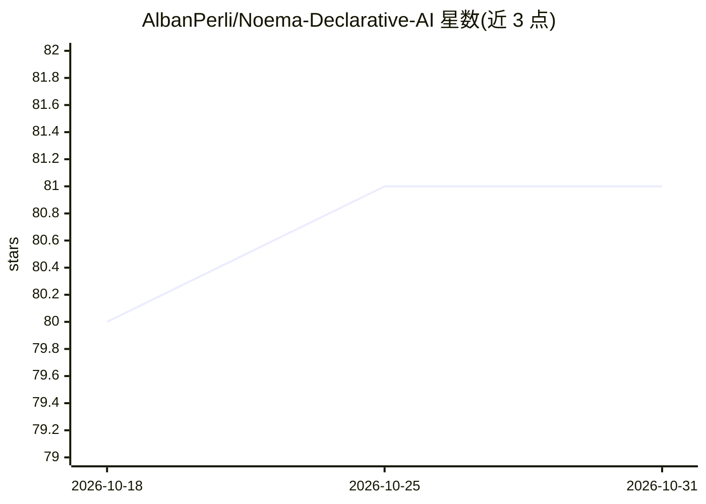

# AlbanPerli/Noema-Declarative-AI

⭐ 81 · Python · Apache-2.0 · 推送 2026-07-22 · [GitHub](https://github.com/AlbanPerli/Noema-Declarative-AI) · 个人维护

**声明式控制 LLM 生成的 Python 框架**

Noema 将声明式编程范式应用于语言模型：开发者用 Python 类型（Int/Sentence/ListOf/Select 等）描述任务（Noesis），框架自动构建提示词、约束并拦截 LLM 生成结果（Noema），转为对应 Python 类型供标准代码使用。支持 ReAct 提示模式、约 40 种语言的代码生成器、SemPy 动态生成并执行 Python 函数，以及生成 PlantUML/Mermaid 反思流程图。基于 llama.cpp 与 guidance 构建，通过本地 gguf 模型文件运行，pip 安装。概念体系借用胡塞尔现象学术语。

## 筛选速览

| 维度 | 判定 | 备注 |
|---|---|---|
| AI 角色 | `ai-ecosystem` | LLM/agent 周边工具 |
| 许可风险 | `permissive` | Apache-2.0 |
| 部署形态 | `library` | 以包/库形式分发 |
| 模型依赖 | local-ok | 支持本地模型 |
| 硬件要求 | — | 无带数字的原话,不猜 |
| 安装摩擦 | `low` | 无编译、无系统依赖或容器化 |
| 成熟度 | — | 结构信号不足 |

## 能力要点

- 声明式类型（Int/Word/ListOf/Select 等）约束生成并返回 Python 类型
- SemPy 动态生成并执行 Python 函数
- 支持约 40 种语言的代码生成器
- write_graph 生成 PlantUML/Mermaid 反思流程图

## 适用场景

- 在 Python 代码中声明式地调用本地 LLM 获得结构化输出
- 用 ReAct 模式编排 LLM 的反思步骤
- 约束 LLM 按选项或类型生成可复用值

## 场景标签

`Agent 框架` · 领域:Agent 开发

## 证据(README 行号)

> L6:  This framework aims to enable developers to use **LLMs as thought interpreters**, not as a source of truth.
> L37: **Noema is an application of the *declarative* programming paradigm to a language model.**

## 星数曲线

2026-10-18 80 → 2026-10-31 81（+1）

---
*卡片 v1 · prompt 1.4 · 生成 2026-10-24 · 置信度 high · 依据 README sha `04768b7f35d3` · [字段定义](../../DATASET.md)*
