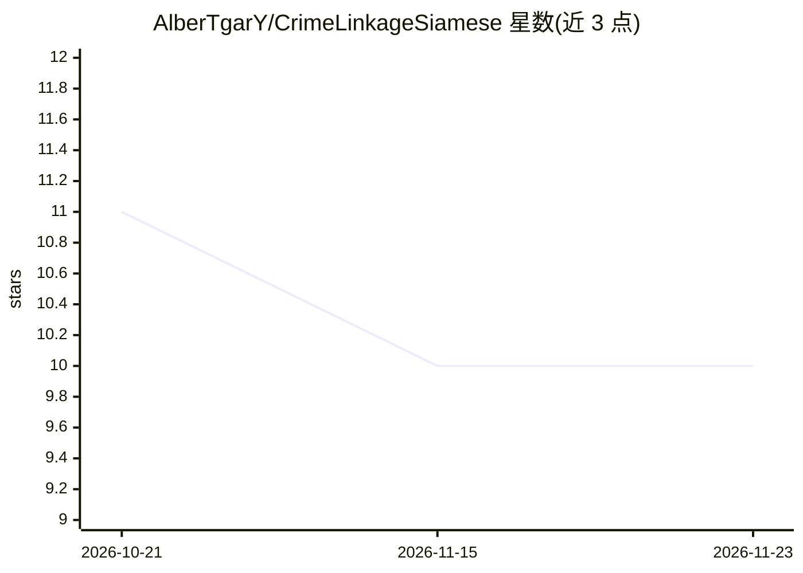

# AlberTgarY/CrimeLinkageSiamese

⭐ 10 · Python · 推送 2026-03-21 · [GitHub](https://github.com/AlberTgarY/CrimeLinkageSiamese) · [官网](https://ojs.aaai.org/index.php/AAAI/article/view/41309) · 组织维护

**AAAI 2026 论文的犯罪串并案 Siamese 网络实现**

AAAI 2026 论文《Enhancing Binary Encoded Crime Linkage Analysis Using Siamese Network》的官方实现。提出 Siamese Autoencoder 框架，从高维稀疏的二值编码犯罪数据（ViCLAS）学习潜在表示，并在解码器阶段融合地理-时间特征。提供训练、测试与地理-时间数据加载的脚本与示例代码。依赖 PyTorch、pandas、scikit-learn 等 Python 库，需 16GB 以上内存。数据因保密协议不公开，研究者需向英国国家犯罪局提交正式访问申请；代码仅限学术研究用途，商用需许可。

## 筛选速览

| 维度 | 判定 | 备注 |
|---|---|---|
| AI 角色 | `ai-native` | 本体是模型或模型工具 |
| 许可风险 | `none` | — |
| 部署形态 | `library` | 以包/库形式分发 |
| 模型依赖 | — | README 未给出锁定关系 |
| 硬件要求 | — | 无带数字的原话,不猜 |
| 安装摩擦 | `low` | 无编译、无系统依赖或容器化 |
| 成熟度 | — | 结构信号不足 |

## 能力要点

- Siamese Autoencoder 框架，处理高维稀疏二值编码犯罪数据
- 解码器阶段融合地理-时间特征
- 论文报告相对传统方法最高 9% AUC 提升
- 提供训练、测试与地理-时间数据加载脚本

## 适用场景

- 在获得 ViCLAS 数据访问权限后复现论文实验
- 在自己的犯罪串并案数据集上训练与评估模型
- 研究二值编码数据的 Siamese 表示学习方法

## 场景标签

`科研工具` · 领域:学习与行业

## 证据(README 行号)

> L25: We propose a Siamese Autoencoder framework for crime linkage analysis that learns meaningful latent representations
> L47: Train the Siamese Autoencoder on your crime linkage dataset:

## 星数曲线

2026-10-21 11 → 2026-11-23 10（-1）

---
*卡片 v1 · prompt 1.4 · 生成 2026-11-20 · 置信度 high · 依据 README sha `5fb39baabdc9` · [字段定义](../../DATASET.md)*
