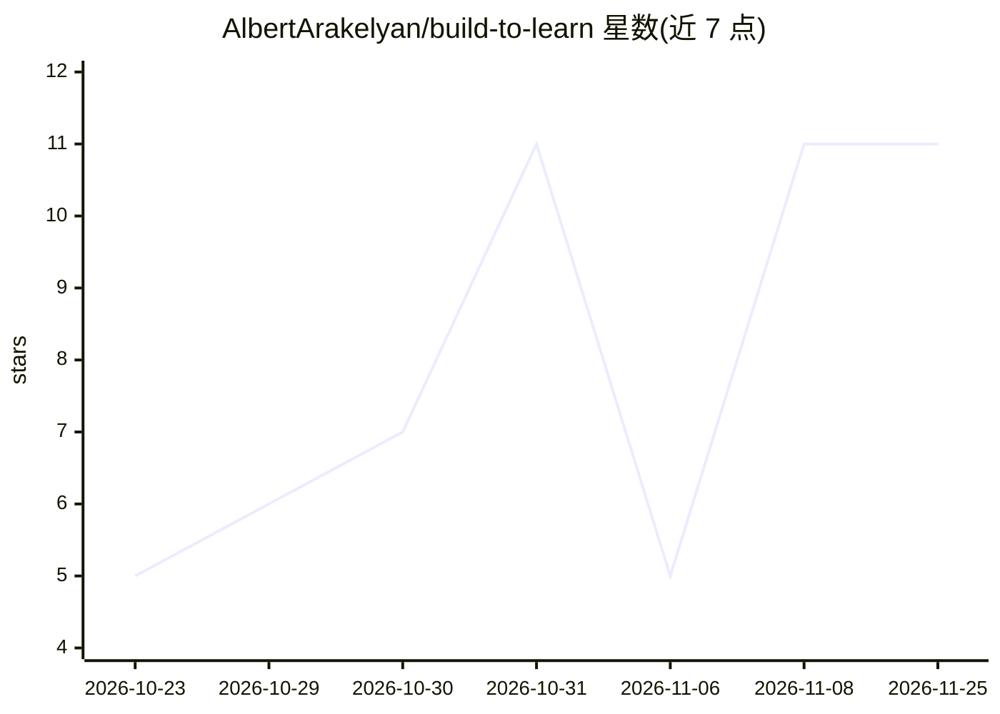

# AlbertArakelyan/build-to-learn

⭐ 11 · JavaScript · MIT · 推送 2026-10-09 · [GitHub](https://github.com/AlbertArakelyan/build-to-learn) · [官网](https://albertarakelyan.github.io/build-to-learn) · 个人维护

**以做小应用学技术栈的 agent 插件/技能，产出分层文档**

一个面向 Claude Code 的插件，同时可作为 Codex、opencode 等 agent 的技能安装。用户指定想学的技术栈后，agent 构建一个刻意精简的端到端小应用（覆盖工具链、构建、运行、发布），过程中将遇到的错误与问题记入学习日志，最终沉淀为 README、DEV_DOCS.md 和可复用模板，文档是主要交付物。支持全局/项目级安装、学习日志追加、主题文档生成与状态查看等命令，并在系统级修改前先询问和备份。

## 筛选速览

| 维度 | 判定 | 备注 |
|---|---|---|
| AI 角色 | `ai-enhanced` | 去掉 AI 部分产品仍成立 |
| 许可风险 | `permissive` | MIT |
| 部署形态 | `library` | 以包/库形式分发 |
| 模型依赖 | — | README 未给出锁定关系 |
| 硬件要求 | — | 无带数字的原话,不猜 |
| 安装摩擦 | `medium` | 含编译或系统依赖之一 |
| 成熟度 | — | 结构信号不足 |

## 能力要点

- 构建覆盖完整链条的精简小应用，日志记录每个问题并沉淀为分层文档
- 提供 /build-to-learn 命令集：日志、文档生成、主题文件、状态查看
- 支持 Claude Code 插件（user/project/local 三种作用域）与 Codex/opencode 技能两种安装方式
- 系统级修改前询问并备份，标记未验证内容为 "not tested yet"

## 适用场景

- 通过端到端做一个小应用来学习新框架或语言
- 为团队沉淀可复用的技术栈项目模板与开发文档
- 把踩坑过程整理成主题化参考文档（如 linux build）

## 场景标签

`教程课程` · 领域:学习与行业

## 证据(README 行号)

> L5: `/build-to-learn` is a plugin for **Claude Code**, and a skill for **Codex**, **opencode** and other agents.
> L72: |`/build-to-learn <what you want to learn>`|Full workflow: scope a tiny app, set up the toolchain, build, run, ship

## 星数曲线

2026-10-23 5 → 2026-11-25 11（+6）

---
*卡片 v1 · prompt 1.4 · 生成 2026-11-19 · 置信度 high · 依据 README sha `fa7e2548f6cc` · [字段定义](../../DATASET.md)*
