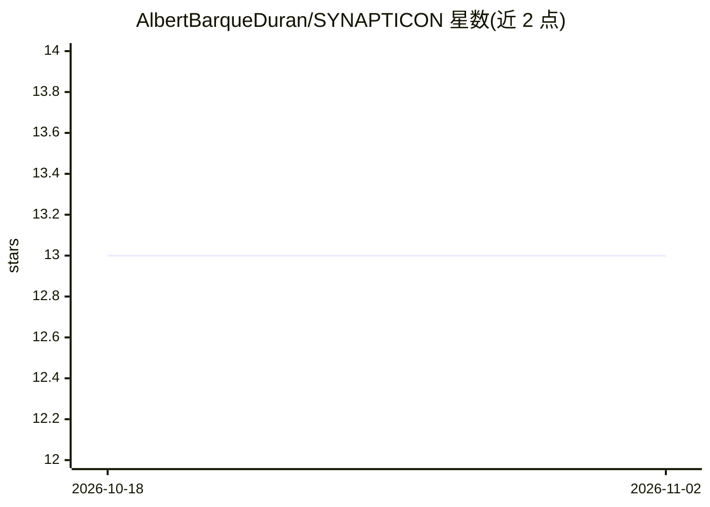

# AlbertBarqueDuran/SYNAPTICON

⭐ 13 · Python · NOASSERTION · 推送 2025-12-12 · [GitHub](https://github.com/AlbertBarqueDuran/SYNAPTICON) · [官网](https://albert-data.com/pages/synapticon) · 个人维护

**EEG 信号解码为文本的 BCI 研究原型：脑电→自然语言闭环**

研究原型仓库，提供从脑电采集到文本生成的完整流水线：用 BrainFlow 兼容板（如 OpenBCI Cyton+Daisy 16 通道）记录 EEG，经陷波与带通滤波压缩为 .npz 张量，用 1D CNN 编码器加 Transformer decoder-only 语言模型从 EEG 窗口预测对应文本 token，并支持加载 checkpoint 进行实时闭环推理。本仓库为轻量版编码器，原始系统用 bi-LSTM 接入 BART-base。面向 BCI、语音解码与神经美学研究者；模型权重与 EEG 数据不随仓库分发，需自行采集并遵守伦理/IRB 规定。代码以 MIT 许可发布。

## 筛选速览

| 维度 | 判定 | 备注 |
|---|---|---|
| AI 角色 | `ai-native` | 本体是模型或模型工具 |
| 许可风险 | `none` | NOASSERTION |
| 部署形态 | `library` | 以包/库形式分发 |
| 模型依赖 | — | README 未给出锁定关系 |
| 硬件要求 | — | 无带数字的原话,不猜 |
| 安装摩擦 | `low` | 无编译、无系统依赖或容器化 |
| 成熟度 | `idea` | |

## 能力要点

- EEG→文本四阶段流水线：采集、预处理、训练、实时推理
- 1D CNN 编码 + Transformer decoder-only 语言模型条件生成文本
- 支持 BrainFlow 兼容硬件（OpenBCI Cyton+Daisy 16 通道）
- Apple Silicon 上 PyTorch 自动使用 MPS 后端

## 适用场景

- 复现 foundation-model 辅助的非侵入式 BCI 语音解码研究
- 采集自己的 EEG 数据并训练 EEG→文本生成模型
- 构建实时闭环的神经信号解码实验装置

## 场景标签

`科研工具` · 领域:学习与行业

## 证据(README 行号)

> L28: - **EEG→Text modeling**: A custom neural architecture encodes the multichannel EEG window with a stack of 1D CNN la
> L84: python scripts/inference_live.py   --model models/best_eeg2text_epochXX.pt   --sentences_csv data/synapticon_senten

## 星数曲线

2026-10-18 13 → 2026-11-02 13（+0）

---
*卡片 v1 · prompt 1.4 · 生成 2026-10-31 · 置信度 mid · 依据 README sha `20cc48bd2d01` · [字段定义](../../DATASET.md)*
