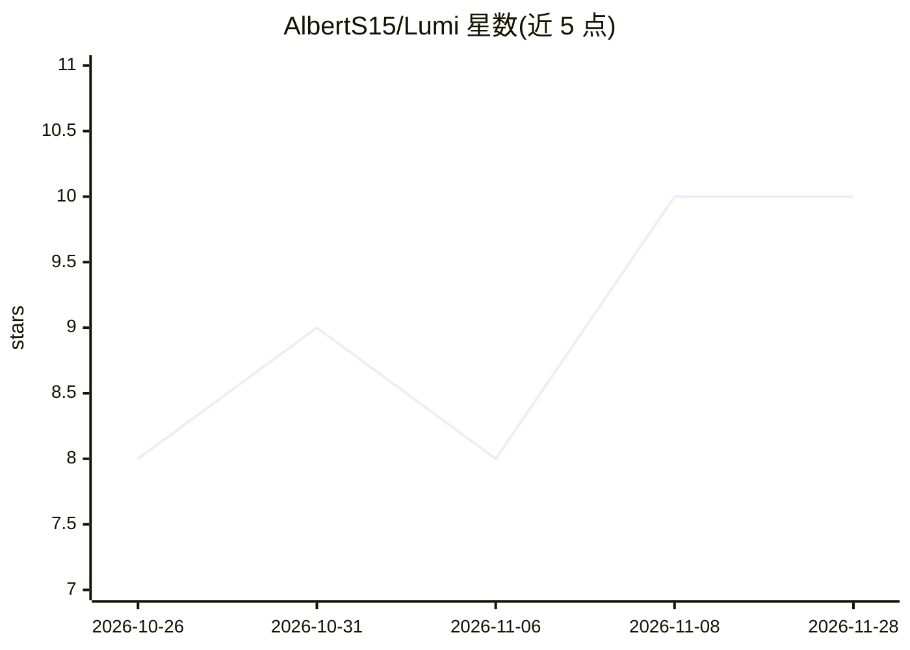

# AlbertS15/Lumi

⭐ 10 · C# · MIT · 推送 2026-11-11 · [GitHub](https://github.com/AlbertS15/Lumi) · [官网](https://alberts15.github.io/Lumi/) · 个人维护

**Spotlight 风格启动器，可搜索应用文件并向多家 AI 提问**

跨 macOS/Windows/Linux 的启动条：一个快捷键唤起，可搜索应用与文件（Mac 用 Spotlight 索引、Windows 用开始菜单和 Windows Search），也可向 Claude、ChatGPT、Gemini、本地模型提问，答案在条内流式显示并支持追问。通过各服务官方工具（Claude Code、Codex CLI、Gemini CLI）支持订阅免 API key 使用，也支持任意 OpenAI 兼容服务与 Ollama/LM Studio 本地模型；Ask my files 功能用本地 Ollama 回答本机文档。密钥存于系统钥匙串或加密存储。

## 筛选速览

| 维度 | 判定 | 备注 |
|---|---|---|
| AI 角色 | `ai-enhanced` | 去掉 AI 部分产品仍成立 |
| 许可风险 | `permissive` | MIT |
| 部署形态 | `desktop` | 安装包/桌面程序 |
| 模型依赖 | local-ok | 支持本地模型 |
| 硬件要求 | — | 无带数字的原话,不猜 |
| 安装摩擦 | `medium` | 含编译或系统依赖之一 |
| 成熟度 | — | 结构信号不足 |

## 能力要点

- 订阅免 API key：经 Claude Code、Codex CLI、Gemini CLI 官方工具接入
- 支持 Ollama 与 LM Studio 本地离线模型，以及任意 OpenAI 兼容服务
- Ask my files（实验性）：用本地 Ollama 回答本机 txt/md/pdf/docx 文件
- macOS/Windows/Linux 安装包，五种界面语言，快捷键可自定义

## 适用场景

- 用快捷键快速搜索并打开应用和文件
- 不注册 API key，用已有订阅直接向多家 AI 提问
- 在离线环境下用本地模型回答问题
- 对本地文档目录提问并得到回答

## 场景标签

`AI 助手` `聊天机器人` `文档问答` · 领域:对话与助手

## 证据(README 行号)

> L5: **A Spotlight-style bar for macOS, Windows and Linux that also answers questions.** One hotkey opens an app or file,
> L27: - **Search** apps and files: the Spotlight index on Mac, the Start menu and Windows Search on Windows. Lumi tells a
> L30: - **Subscriptions without API keys**, through each service's official tool:

## 星数曲线

2026-10-26 8 → 2026-11-28 10（+2）

---
*卡片 v1 · prompt 1.4 · 生成 2026-11-20 · 置信度 high · 依据 README sha `585229aa86b0` · [字段定义](../../DATASET.md)*
