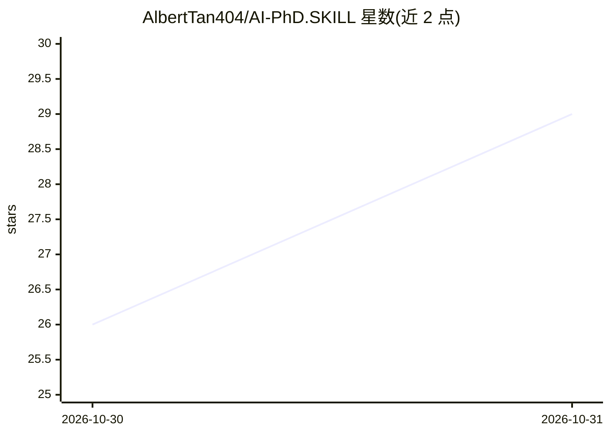

# AlbertTan404/AI-PhD.SKILL

⭐ 29 · 推送 2026-10-28 · [GitHub](https://github.com/AlbertTan404/AI-PhD.SKILL) · [官网](https://www.xiaohongshu.com/user/profile/673b4c44000000001d02d37e) · 个人维护 · 中文 README

**面向 AI 博士生的科研经验与技术开放笔记集**

由人大高瓴人工智能学院博士生 Albert Wenhui Tan 维护的开放笔记仓库：围绕选题、科研 Pipeline、论文写作与 Rebuttal、交流建联、研究判断，以及 RL（PPO/GRPO/GAE）与软件工程等主题组织文章，中英双语对照，每篇可独立阅读。文件按 SKILLS/<topic>/ 分类存放，中文为基准、英文为 AI 辅助翻译；含 drafts 草稿与社交配文目录。内容含大量主观观点，通过 Issue/PR 接受修订。

## 筛选速览

| 维度 | 判定 | 备注 |
|---|---|---|
| AI 角色 | `ai-knowledge` | 知识聚合/清单类 |
| 许可风险 | `none` | — |
| 部署形态 | `None` |  |
| 模型依赖 | — | README 未给出锁定关系 |
| 硬件要求 | — | 无带数字的原话,不猜 |
| 安装摩擦 | `low` | 无编译、无系统依赖或容器化 |
| 成熟度 | — | 结构信号不足 |

## 能力要点

- 覆盖选题、科研 Pipeline、写作交流、研究判断四大主题
- RL 系列：从 Loss 推导 PPO/GRPO、Reward→GAE→GRPO Family
- 中文原文+英文对照双语版本，文章可独立阅读
- 通过 Issue/PR 接受纠错与翻译改进

## 适用场景

- 我刚开始读博，想系统了解选题和科研流程
- 我想图文推导式地理解 PPO/GRPO 等 LLM RL 技术
- 我要写论文和 Rebuttal，想参考写作与表达方法

## 场景标签

`教程课程` · 领域:学习与行业

## 证据(README 行号)

> L9: AI-PhD.SKILL 是一份面向 AI 博士生和研究者的开放笔记：从选题、读论文、做实验，到写作、交流、研究判断，以及 RL 和软件工程。既有个人经历与观察，也有可以跟着推导的技术内容。希望它能帮助你进入一个领域，把问题想清楚，
> L19: AI-PhD.SKILL is a collection of open notes designed for AI PhD students and researchers. It covers a wide range of 

## 星数曲线

2026-10-30 26 → 2026-10-31 29（+3）

---
*卡片 v1 · prompt 1.4 · 生成 2026-10-30 · 置信度 high · 依据 README sha `c83f2a3b7318` · [字段定义](../../DATASET.md)*
