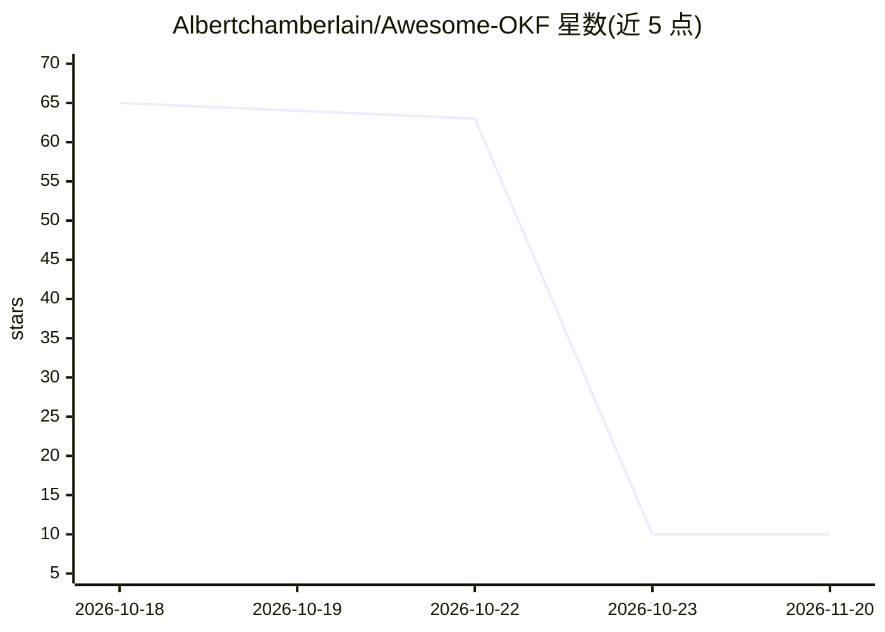

# Albertchamberlain/Awesome-OKF

⭐ 10 · Python · MIT · 推送 2026-11-09 · [GitHub](https://github.com/Albertchamberlain/Awesome-OKF) · 个人维护 · 中文 README

**OKF 知识格式生态的策展目录：供 agent 检索 OKF 资源**

对 Open Knowledge Format（Google Cloud 发布的开放规范）生态资源的策展清单，以 data/catalog.yaml 为单一数据源，收录 29 条条目（4 工具、7 插件、7 技能、5 提案、6 文档），并由此生成多语言 README、可搜索 CLI（awesome-okf search/list）以及可供 AI agent 直接查询的 MCP meta-server。配套 convert-to-okf 转换 CLI，支持从 Markdown 清单、JSON、Obsidian、Notion、飞书、PDF 等来源抽取并打包为 OKF 目录。维护规则要求条目仅经 YAML 修改后重新生成。

## 筛选速览

| 维度 | 判定 | 备注 |
|---|---|---|
| AI 角色 | `ai-knowledge` | 知识聚合/清单类 |
| 许可风险 | `permissive` | MIT |
| 部署形态 | `None` |  |
| 模型依赖 | — | README 未给出锁定关系 |
| 硬件要求 | — | 无带数字的原话,不猜 |
| 安装摩擦 | `low` | 无编译、无系统依赖或容器化 |
| 成熟度 | — | 结构信号不足 |

## 能力要点

- 单一 catalog.yaml 数据源，自动生成五语言 README 与文档
- MCP meta-server 使 AI agent 可直接查询目录
- convert-to-okf CLI 覆盖 Obsidian/Notion/飞书/PDF 等多源转换
- 含 myokf 校验器与 pytest 验证的贡献流程

## 适用场景

- 让 agent 通过 MCP 发现可用的 OKF 插件与工具
- 把已有的 awesome 清单或笔记库转换为 OKF 知识目录
- 查阅 OKF 规范的中英文版本与提案进展

## 场景标签

`精选清单` `知识库管理` · 领域:知识与检索

## 证据(README 行号)

> L5:  The curated catalog of Open Knowledge Format resources.
> L27: Awesome OKF keeps the entire OKF ecosystem in **one validated YAML catalog**, then turns it into a browsable list, 
> L153: > **29 curated entries** · 4 tools · 7 plugins · 7 skills · 5 proposals · 6 docs

## 星数曲线

2026-10-18 65 → 2026-11-20 10（-55）

---
*卡片 v1 · prompt 1.4 · 生成 2026-11-20 · 置信度 high · 依据 README sha `fcab5cb2e576` · [字段定义](../../DATASET.md)*
