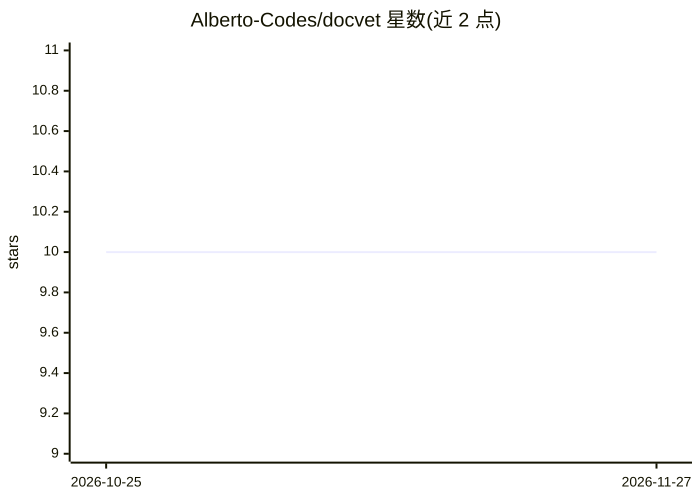

# Alberto-Codes/docvet

⭐ 10 · Python · MIT · 推送 2026-11-15 · [GitHub](https://github.com/Alberto-Codes/docvet) · [官网](https://alberto-codes.github.io/docvet/) · 个人维护

**Python 项目 docstring 质量检查 CLI，服务 AI 编码流程**

docvet 将 docstring 存在性度量、基于 AST 的完整性检查、基于 git diff/blame 的过时信号和 Griffe 渲染诊断合并为一个 CLI，共 32 条规则分 5 类检查。提供 LSP 服务器供编辑器实时诊断，提供 MCP 服务器供 AI agent 集成；可通过 pip、pre-commit 钩子或 GitHub Action 使用。README 说明这些检查标记需复核的文档缺口，不证明文字描述与运行时行为一致。

## 筛选速览

| 维度 | 判定 | 备注 |
|---|---|---|
| AI 角色 | `ai-enhanced` | 去掉 AI 部分产品仍成立 |
| 许可风险 | `permissive` | MIT |
| 部署形态 | `library` | 以包/库形式分发 |
| 模型依赖 | — | README 未给出锁定关系 |
| 硬件要求 | — | 无带数字的原话,不猜 |
| 安装摩擦 | `low` | 无编译、无系统依赖或容器化 |
| 成熟度 | — | 结构信号不足 |

## 能力要点

- 32 条规则覆盖 presence/enrichment/freshness/griffe/coverage 五类检查
- git diff/blame 过时信号与 mkdocs 可见性检查
- 提供 LSP 服务器与 MCP 服务器接口
- 支持 pre-commit 钩子与 GitHub Action 内联标注

## 适用场景

- 在 CI/pre-commit 中检查 docstring 覆盖率与完整性
- 让 AI 编码 agent 在修改代码后运行 docvet 并修复发现
- 查找对 mkdocs 不可见的包目录

## 场景标签

 · 领域:开发者工具/代码质量

## 证据(README 行号)

> L16: docvet combines docstring presence metrics, structural checks, history-based staleness signals, and renderer diagno
> L171: |`docvet mcp`|Start MCP server for AI agent integration|
> L139: Add docvet to your AI coding workflow. Drop this into your `CLAUDE.md`, `.cursorrules`, or agent configuration:

## 星数曲线

2026-10-25 10 → 2026-11-27 10（+0）

---
*卡片 v1 · prompt 1.4 · 生成 2026-11-20 · 置信度 high · 依据 README sha `568a9a51a7b3` · [字段定义](../../DATASET.md)*
