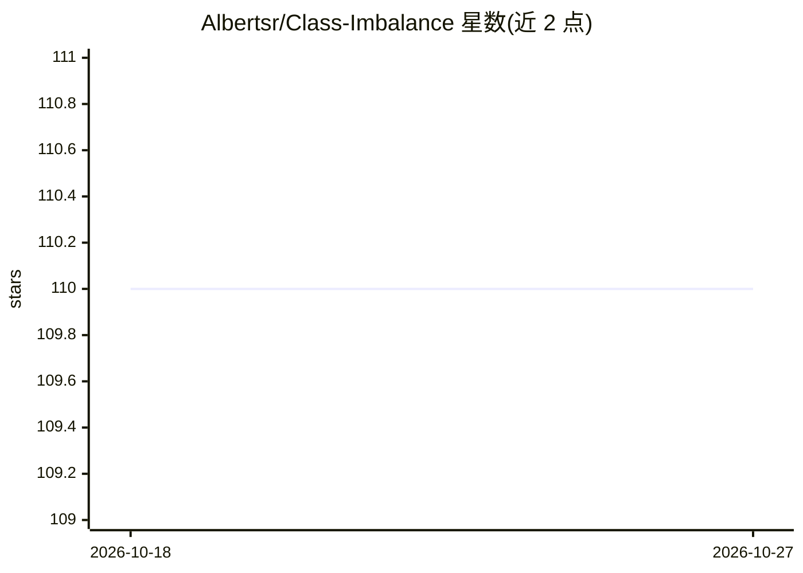

# Albertsr/Class-Imbalance

⭐ 110 · Python · MIT · 推送 2026-07-27 · [GitHub](https://github.com/Albertsr/Class-Imbalance) · 个人维护 · 中文 README

**面向信贷风控的类别不平衡理论方法库：区分重采样、代价敏感与阈值决策**

以中国零售信贷违约概率（PD）建模为主要案例，围绕类别不平衡问题组织理论与代码：将总体与标签、训练信号、排序、概率、决策分层拆开，论证重采样/加权/代价敏感阈值作用于不同层级，0.5 阈值是代价假设而非默认值。现代 Python 包提供二分类指标、概率校正、代价决策、重采样辅助与选定损失函数等可审计模块，另含中文历史理论笔记（马晓 2018-2021）的英文改编版与可选实验目录。

## 筛选速览

| 维度 | 判定 | 备注 |
|---|---|---|
| AI 角色 | `ai-ecosystem` | LLM/agent 周边工具 |
| 许可风险 | `permissive` | MIT |
| 部署形态 | `library` | 以包/库形式分发 |
| 模型依赖 | — | README 未给出锁定关系 |
| 硬件要求 | — | 无带数字的原话,不猜 |
| 安装摩擦 | `low` | 无编译、无系统依赖或容器化 |
| 成熟度 | — | 结构信号不足 |

## 能力要点

- 将总体/标签、训练信号、排序、概率、决策五层证据链显式分离
- 从代价矩阵推导概率阈值 tc，论证 0.5 的成立条件
- Stable 模块含 metrics/operating_points/probability/decision/rebalancing/losses，另含可选与实验性模块（如 experimental.adacost）
- 中文历史理论（马晓 2018-2021 笔记）英文改编，现代修订以编者注形式分离

## 适用场景

- 信贷 PD 建模中选择重采样/加权/阈值策略前厘清估计对象
- 将代价矩阵转化为概率阈值并解释非 0.5 截断的含义
- 理解历史审批选择偏差与标签成熟度对验证集的影响

## 场景标签

 · 领域:金融风控/机器学习

## 证据(README 行号)

> L8: This project is rooted in Chinese credit-risk practice, but the modeling
> L239: The modern package is intentionally small. It provides auditable contracts for
> L245: |Stable|`metrics`, `operating_points`, `probability`, `decision`, `rebalancing`, `losses`|

## 星数曲线

2026-10-18 110 → 2026-10-27 110（+0）

---
*卡片 v1 · prompt 1.4 · 生成 2026-10-23 · 置信度 mid · 依据 README sha `8b3c7e38a788` · [字段定义](../../DATASET.md)*
