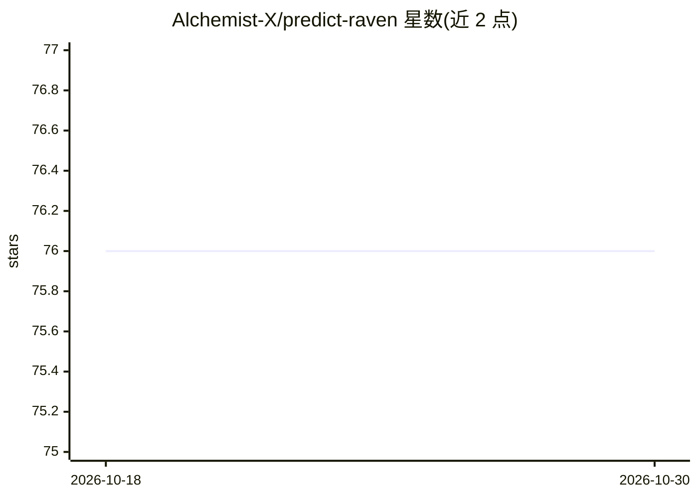

# Alchemist-X/predict-raven

⭐ 76 · TypeScript · MIT · 推送 2026-09-29 · [GitHub](https://github.com/Alchemist-X/predict-raven) · [官网](https://forecasting-agent.com) · 个人维护 · 中文 README

**面向预测市场的自主预测/交易 agent 框架，预测事件概率并交易**

开源预测 agent 框架：AI agent 对真实世界事件估计概率、持续收集带引用证据并据此行动。产品族包括 Polymarket 自主交易 agent（服务层风险控制）、不读市场价格的 2026 世界杯 48 队公开 Brier 评分预测、托管 Forecasting Engine（交互控制台 + Forecast API + MCP 服务）、模拟盘交易 twin 与新闻驱动美股影子交易管道。核心为 packages/forecast-engine 迭代证据预测引擎（框架审计、独立性折减、强制反证等护栏）。实盘循环当前处于暂停状态（2026-06-10 最后一次实盘）；README 披露搜索证据质量已知问题及修复进展（改用 Exa/Tavily）。

## 筛选速览

| 维度 | 判定 | 备注 |
|---|---|---|
| AI 角色 | `ai-native` | 本体是模型或模型工具 |
| 许可风险 | `permissive` | MIT |
| 部署形态 | `library` | 以包/库形式分发 |
| 模型依赖 | — | README 未给出锁定关系 |
| 硬件要求 | — | 无带数字的原话,不猜 |
| 安装摩擦 | `low` | 无编译、无系统依赖或容器化 |
| 成熟度 | `idea` | |

## 能力要点

- 迭代证据预测引擎：带引用来源、强制反证与饱和状态护栏
- Polymarket 自主交易：估算公允概率与市场隐含赔率比对后在风险控制下交易
- 市场盲预测：世界杯 87 题公开 Brier 评分，预测时从不读取市场价格
- 提供 Forecast API + MCP 服务（概率+推理+证据，JSON/文本/PDF）

## 适用场景

- 在预测市场按自估概率与市场赔率的差进行自主交易
- 产出与市场价格独立的公开可评分事件概率预测
- 通过 API/MCP 获取带证据链的事件概率与推理报告
- 运行全自动模拟盘验证交易策略

## 场景标签

`Agent 框架` `金融量化` · 领域:Agent 开发

## 证据(README 行号)

> L11: **predict-raven** is an open-source **forecasting agent framework**: it lets an AI agent estimate the probability o
> L13: - **Autonomous prediction-market trading** — the first autonomous, continuously-running trading agent on Polymarket
> L57: Everything in this repo is built around one capability: an AI agent that can research a question about the future, 

## 星数曲线

2026-10-18 76 → 2026-10-30 76（+0）

---
*卡片 v1 · prompt 1.4 · 生成 2026-10-24 · 置信度 mid · 依据 README sha `7d7b42d00c28` · [字段定义](../../DATASET.md)*
