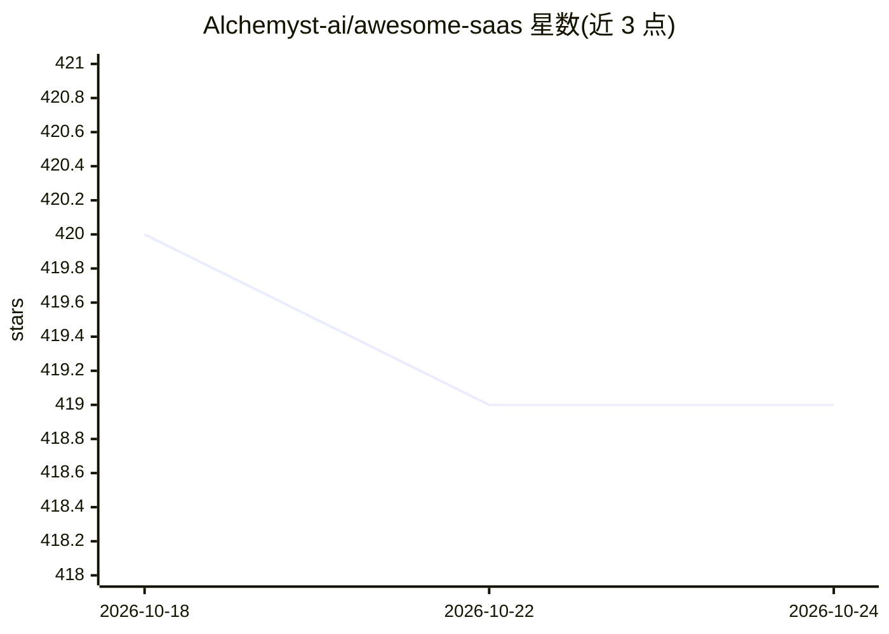

# Alchemyst-ai/awesome-saas

⭐ 419 · TypeScript · MIT · 推送 2026-10-23 · [GitHub](https://github.com/Alchemyst-ai/awesome-saas) · [官网](https://alchemyst-ai.github.io/awesome-saas/) · 组织维护

**基于 Alchemyst AI 平台的社区模板与 AI Agent 作品集**

由 Alchemyst AI 团队维护的策展仓库，收录基于 Alchemyst AI 平台构建的官方模板、社区模板与社区 AI Agent（如邮件代理、Deep Research、PDF 问答、营销自动化等）。条目以表格列出项目名、星数、描述与主题标签，通过仓库 topic 标签 alchemyst-awesome-saas 自动聚合，每日 UTC 12:00 刷新；另提供平台 API 文档链接、贡献指南与贡献者排行榜。仓库本身不含可运行代码，各项目跳转至独立 GitHub 仓库。

## 筛选速览

| 维度 | 判定 | 备注 |
|---|---|---|
| AI 角色 | `ai-knowledge` | 知识聚合/清单类 |
| 许可风险 | `permissive` | MIT |
| 部署形态 | `None` |  |
| 模型依赖 | — | README 未给出锁定关系 |
| 硬件要求 | — | 无带数字的原话,不猜 |
| 安装摩擦 | `low` | 无编译、无系统依赖或容器化 |
| 成熟度 | — | 结构信号不足 |

## 能力要点

- 按官方模板/社区模板/社区 Agent 分类的项目清单
- 通过 topic 标签 alchemyst-awesome-saas 自动聚合，每日刷新
- 附平台 API 文档（OpenAPI）链接与贡献者排行榜

## 适用场景

- 查找基于 Alchemyst AI 平台的启动模板
- 发现社区构建的 AI Agent 与 SaaS 项目案例
- 将自己的 Alchemyst 项目提交进清单获得曝光

## 场景标签

`精选清单` · 领域:学习与行业

## 证据(README 行号)

> L83:  ## 📦 Templates
> L47:  🧠 Community AI Agents

## 星数曲线

2026-10-18 420 → 2026-10-24 419（-1）

---
*卡片 v1 · prompt 1.4 · 生成 2026-10-21 · 置信度 high · 依据 README sha `0cfe7445d099` · [字段定义](../../DATASET.md)*
