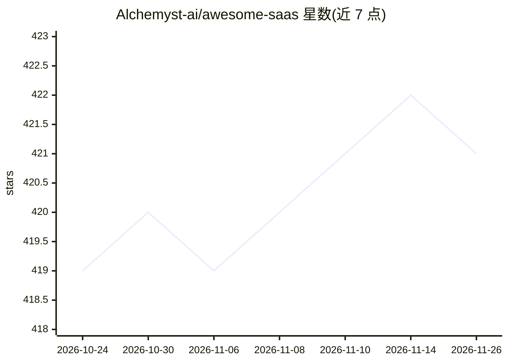

# Alchemyst-ai/awesome-saas

⭐ 421 · TypeScript · MIT · 推送 2026-11-25 · [GitHub](https://github.com/Alchemyst-ai/awesome-saas) · [官网](https://alchemyst-ai.github.io/awesome-saas/) · 组织维护

**为开发者提供的 Alchemyst AI 平台模板与 Agent 项目清单**

由 Alchemyst AI 团队维护的模板合集（Cookbook）：收录社区构建的 5 个 AI Agent 与 20 余个基于 Alchemyst AI 平台的项目模板，涵盖邮件自动化、招聘、深度研究、爬虫营销、PDF 问答等场景；提供平台 API 文档、OpenAPI 链接与 curl 快速开始命令，并通过仓库 topic 与每日定时刷新的机制接收社区贡献，附贡献者排行榜。条目均链接到各自独立仓库，README 本身不含各模板的安装说明。

## 筛选速览

| 维度 | 判定 | 备注 |
|---|---|---|
| AI 角色 | `ai-knowledge` | 知识聚合/清单类 |
| 许可风险 | `permissive` | MIT |
| 部署形态 | `None` |  |
| 模型依赖 | — | README 未给出锁定关系 |
| 硬件要求 | — | 无带数字的原话,不猜 |
| 安装摩擦 | `low` | 无编译、无系统依赖或容器化 |
| 成熟度 | — | 结构信号不足 |

## 能力要点

- 收录社区 AI Agent 与官方/社区模板两类条目
- 提供平台 OpenAPI 与交互式 API 文档入口
- curl 命令快速开始调用平台 API
- 按 topic 提交 PR + 每日 UTC 0 点自动刷新收录

## 适用场景

- 为下一个 AI 应用寻找基于 Alchemyst 平台的起步模板
- 浏览社区已构建的 AI Agent 项目获取思路
- 把自己做的 Alchemyst 项目提交进清单获得曝光

## 场景标签

`精选清单` · 领域:学习与行业

## 证据(README 行号)

> L48:  These agents are part of the awesome-saas collection.
> L83:  ## 📦 Templates
> L105: This is an ever expanding list - we'll keep on adding open source templates!

## 星数曲线

2026-10-24 419 → 2026-11-26 421（+2）

---
*卡片 v1 · prompt 1.4 · 生成 2026-11-25 · 置信度 high · 依据 README sha `8d3ebbdde2b4` · [字段定义](../../DATASET.md)*
