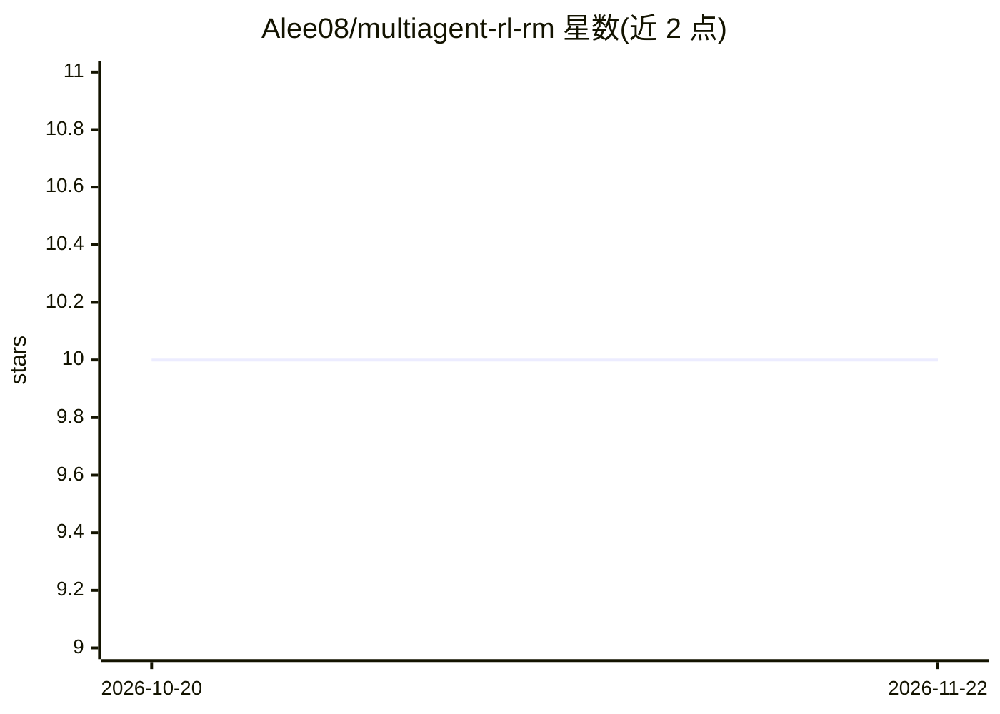

# Alee08/multiagent-rl-rm

⭐ 10 · Python · Apache-2.0 · 推送 2026-07-01 · [GitHub](https://github.com/Alee08/multiagent-rl-rm) · 个人维护

**多智能体强化学习库：以 Reward Machines 定义并求解任务**

面向研究者的 Python 库，用于构建多智能体问题并通过强化学习求解，支持以 Reward Machines（小型自动机）形式模块化定义目标与规则。内置 FrozenLake、OfficeWorld 等环境与状态/动作编码器、事件检测器，提供 Q-learning 等学习算法的统一接口；rmgen CLI 可从自然语言文本生成并校验 RM 规格（离线 mock 或经 Ollama 的 OpenAI 兼容本地模型），随后用 --rm-spec 加载训练。渲染依赖 pygame。曾支撑 ECAI 2025 与 IJCAI-ECAI 2026 论文的可复现实现。

## 筛选速览

| 维度 | 判定 | 备注 |
|---|---|---|
| AI 角色 | `ai-native` | 本体是模型或模型工具 |
| 许可风险 | `permissive` | Apache-2.0 |
| 部署形态 | `self-host` | docker 或自建部署 |
| 模型依赖 | local-ok | 支持本地模型 |
| 硬件要求 | — | 无带数字的原话,不猜 |
| 安装摩擦 | `low` | 无编译、无系统依赖或容器化 |
| 成熟度 | — | 结构信号不足 |

## 能力要点

- Reward Machines 以自动机形式模块化定义多智能体任务
- rmgen CLI 从自然语言生成并校验 RM 规格（mock 离线 / Ollama 本地模型）
- 内置 FrozenLake、OfficeWorld 等环境，支持每智能体独立 RM
- Q-learning 等算法统一接口，含反事实更新与势函数 shaping 选项

## 适用场景

- 研究多智能体强化学习与非马尔可夫奖励任务
- 复现 ECAI/IJCAI 论文中基于 Reward Machines 的实验
- 用自然语言描述任务并生成 RM 规格后直接训练

## 场景标签

`多智能体` `强化学习` · 领域:Agent 开发

## 证据(README 行号)

> L8: The Multi-Agent RLRM (Reinforcement Learning with Reward Machines) Framework is a library designed to facilitate the
> L62: `rmgen` turns text (NL or a compact RM description) into a validated RM spec (`.json`/`.yaml`).
> L254: All algorithms live in `multiagent_rlrm/learning_algorithms` and expose a common interface via `choose_action(...)

## 星数曲线

2026-10-20 10 → 2026-11-22 10（+0）

---
*卡片 v1 · prompt 1.4 · 生成 2026-11-20 · 置信度 high · 依据 README sha `9a0a687ba960` · [字段定义](../../DATASET.md)*
