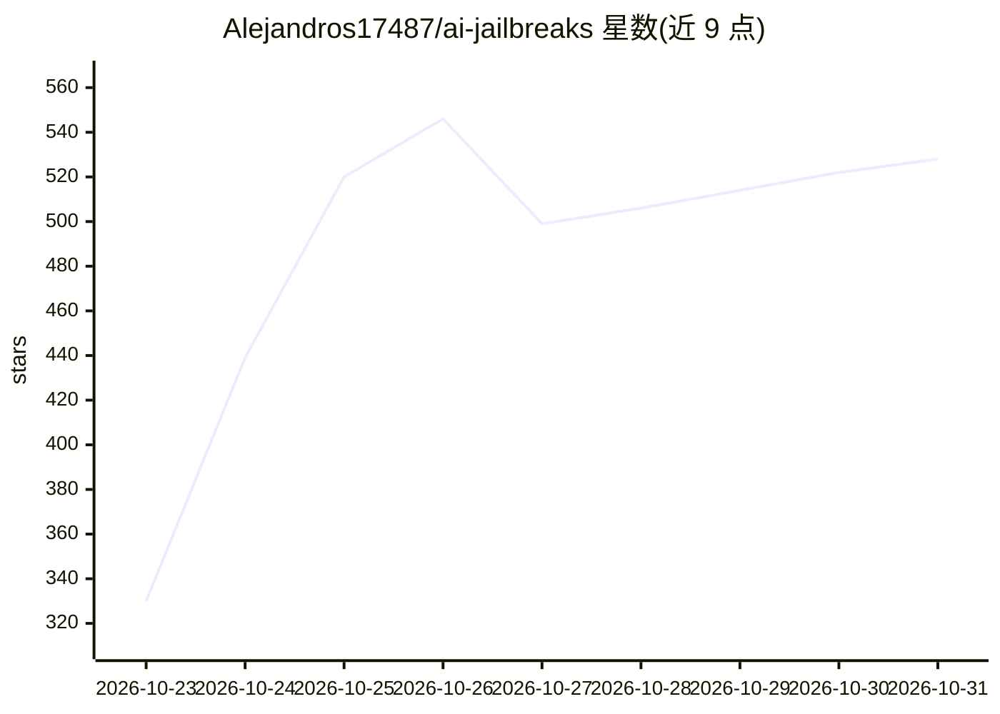

# Alejandros17487/ai-jailbreaks

⭐ 528 · 推送 2026-10-21 · [GitHub](https://github.com/Alejandros17487/ai-jailbreaks) · 个人维护

**面向 25+ 模型的 35 条越狱提示词合集，用于 AI 安全研究**

收录 35 条完整可粘贴的越狱提示词，覆盖 25+ 个前沿与开源权重模型（Claude、GLM、DeepSeek、Kimi、Grok、Gemini、Qwen、Gemma 等），格式包括系统提示词、AGENTS.md 规格、工作区策略与 Ollama Modelfile。README 声明仅供研究与教育用途，用于理解人格设定、指令层级与提示冲突对模型行为的影响。使用方式为将文件内容粘贴到客户端的系统提示词或自定义指令字段，或保存为 AGENTS.md 供编码 agent 读取，Modelfile 可直接通过 ollama create 导入。

## 筛选速览

| 维度 | 判定 | 备注 |
|---|---|---|
| AI 角色 | `ai-knowledge` | 知识聚合/清单类 |
| 许可风险 | `none` | — |
| 部署形态 | `None` |  |
| 模型依赖 | local-ok | 支持本地模型 |
| 硬件要求 | — | 无带数字的原话,不猜 |
| 安装摩擦 | `low` | 无编译、无系统依赖或容器化 |
| 成熟度 | — | 结构信号不足 |

## 能力要点

- 35 条完整提示词覆盖 25+ 模型，含系统提示词/AGENTS.md/Ollama Modelfile 等格式
- 按模型厂商分类索引（Anthropic/Zhipu/DeepSeek/Moonshot/xAI/Google 等）
- Ollama Modelfile 可通过 ollama create 直接导入
- README 附带研究与教育用途免责声明

## 适用场景

- 红队测试中研究提示注入与越狱手法
- 开发者了解人格设定与指令层级如何影响模型行为以加固防御
- 为特定模型查找可粘贴的提示词实验素材

## 场景标签

`网络安全` · 领域:学习与行业

## 证据(README 行号)

> L20: This repo holds **35 paste-ready prompts for 25+ models**: full system prompts, persona definitions, workspace poli
> L35: > This repo documents how persona framing, instruction hierarchies, prompt conflicts, and policy overrides shape mo

## 星数曲线

2026-10-23 330 → 2026-10-31 528（+198）

---
*卡片 v1 · prompt 1.4 · 生成 2026-10-22 · 置信度 high · 依据 README sha `df69dbe8f9fb` · [字段定义](../../DATASET.md)*
