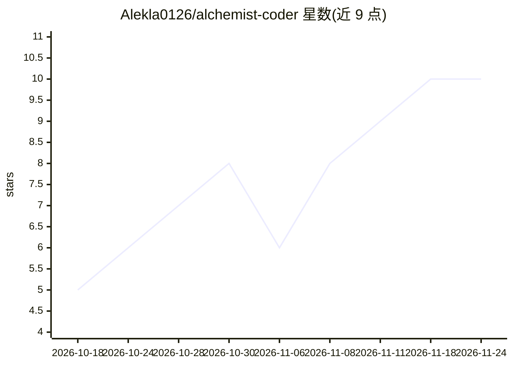

# Alekla0126/alchemist-coder

⭐ 10 · TypeScript · AGPL-3.0 · 推送 2026-11-04 · [GitHub](https://github.com/Alekla0126/alchemist-coder) · [官网](https://coder.alekla.com) · 组织维护

**管理 Claude Code/Codex 等 coding agent 的桌面客户端**

面向使用 Claude Code、Codex、Gemini CLI、Grok Build 的开发者的开源桌面应用：通过 Agent Client Protocol 统一接入四个 CLI，实时展示子代理树、工具调用、diff、token 与成本；提供代理组织图与协调者、Autopilot 自动批准、可代理浏览器的 Board 任务流、自然语言描述的自动化流程、四 CLI 统一全文检索历史、可选版本化 git 备份、Arena 多代理并行竞赛。支持 Ollama/LM Studio 本地模型离线运行。社区版 AGPL-3.0，Pro 版为专有许可。安装包未签名，需手动放行。

## 筛选速览

| 维度 | 判定 | 备注 |
|---|---|---|
| AI 角色 | `ai-ecosystem` | LLM/agent 周边工具 |
| 许可风险 | `viral` | AGPL-3.0 |
| 部署形态 | `library` | 以包/库形式分发 |
| 模型依赖 | local-ok | 支持本地模型 |
| 硬件要求 | — | 无带数字的原话,不猜 |
| 安装摩擦 | `low` | 无编译、无系统依赖或容器化 |
| 成熟度 | — | 结构信号不足 |

## 能力要点

- 经 ACP 统一接入 Claude Code/Codex/Gemini CLI/Grok Build 四个编码代理 CLI
- 代理组织：协调者规划并分派任务，Autopilot 自动批准且拒绝不可撤销操作
- 四个 CLI 历史索引为本地 SQLite 全文检索，原文件只读不改
- 支持 Ollama/LM Studio 本地模型，Claude Code 与 Codex 可完全离线运行

## 适用场景

- 在图形界面里同时跟踪多个项目所有 agent 与 subagent 的实时状态
- 用组织图把任务分派给带角色与权限配置的多个 agent
- 把日常例程写成自动化流程，通过 Telegram 接收询问
- 跨 Claude Code/Codex/Gemini CLI/Grok 检索全部历史会话

## 场景标签

`编码 Agent` `多智能体` · 领域:Agent 开发

## 证据(README 行号)

> L5: A free, open-source desktop app for Claude Code and Codex. Follow every agent and every subagent it spawns, live. Gi
> L48: - **Four coding agents, one workspace.** Claude Code, Codex, Gemini CLI and Grok Build run through the Agent Client
> L66: ||Community (this repo)|Pro|

## 星数曲线

2026-10-18 5 → 2026-11-24 10（+5）

---
*卡片 v1 · prompt 1.4 · 生成 2026-11-20 · 置信度 mid · 依据 README sha `2e36123e9ae5` · [字段定义](../../DATASET.md)*
