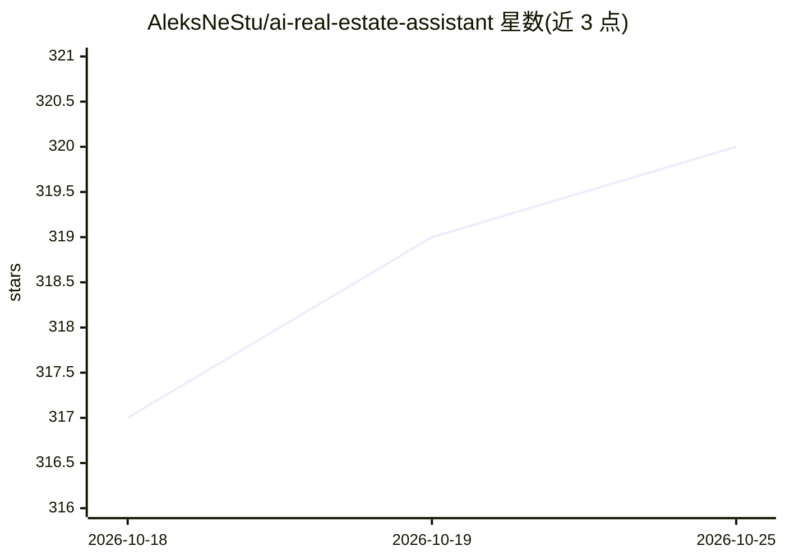

# AleksNeStu/ai-real-estate-assistant

⭐ 320 · Python · MIT · 推送 2026-10-20 · [GitHub](https://github.com/AleksNeStu/ai-real-estate-assistant) · [官网](https://realestate-web-dz1y.onrender.com/) · 个人维护

**面向购房者的 AI 对话式房产搜索与分析平台**

全栈 Web 应用（FastAPI + Next.js），支持自然语言房产搜索、对话式 AI 助手、按揭/租金-购买/ROI/TCO 金融工具、AI 房产估值与多年价格预测、社区 AI 摘要、Mapbox/Leaflet 地图与 9 语言界面。检索采用 ChromaDB 混合语义+关键词搜索与 MMR 重排，查询复杂度分类器将请求路由到 RAG 或 agent+工具路径。接入 16 家 LLM 提供商（含本地 Ollama）并带自动回退链；提供 Docker/脚本/手动三种部署方式与免登录在线演示。演示模式使用模拟 AI 响应，生产部署需 API key。

## 筛选速览

| 维度 | 判定 | 备注 |
|---|---|---|
| AI 角色 | `ai-native` | 本体是模型或模型工具 |
| 许可风险 | `permissive` | MIT |
| 部署形态 | `desktop` | 安装包/桌面程序 |
| 模型依赖 | local-ok | 支持本地模型 |
| 硬件要求 | — | 无带数字的原话,不猜 |
| 安装摩擦 | `low` | 无编译、无系统依赖或容器化 |
| 成熟度 | — | 结构信号不足 |

## 能力要点

- 16 家 LLM 提供商接入与自动回退链，含本地 Ollama
- ChromaDB 混合语义+关键词搜索与 MMR 重排，查询复杂度分类路由（RAG/agent）
- AI 房产估值与 1/3/5/10 年价格预测（含置信区间）
- 9 语言界面与金融工具（按揭、租金-购买、ROI、TCO、CMA 报告）

## 适用场景

- 用自然语言查找符合条件的房源（如'克拉科夫 50 万以下两居室'）
- 获取房产估值与多年价格预测辅助投资决策
- 对比租房与购房成本并计算投资回报率
- 通过 AI 聊天界面浏览房源与市场分析

## 场景标签

`聊天机器人` `AI 助手` `语义搜索` · 领域:对话与助手

## 证据(README 行号)

> L3: > **AI-powered conversational platform for property search, analytics, and market insights.**
> L28: - 🔍 **Natural Language Property Search** — ask questions like *"2-bedroom apartment in Kraków under 500k"* and get 
> L130: 16 LLM providers with intelligent routing — OpenAI, Anthropic, Google, Grok, DeepSeek, OpenRouter, Together AI, Fi

## 星数曲线

2026-10-18 317 → 2026-10-25 320（+3）

---
*卡片 v1 · prompt 1.4 · 生成 2026-10-21 · 置信度 high · 依据 README sha `12a69c28abf9` · [字段定义](../../DATASET.md)*
