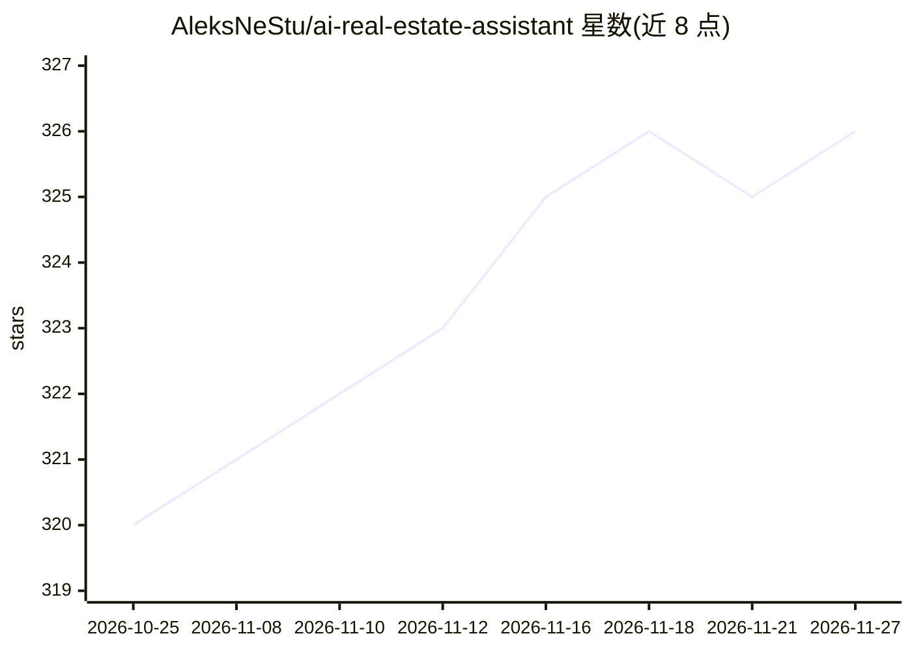

# AleksNeStu/ai-real-estate-assistant

⭐ 326 · Python · MIT · 推送 2026-11-26 · [GitHub](https://github.com/AleksNeStu/ai-real-estate-assistant) · [官网](https://realty.kittray.com) · 个人维护

**开源自托管房产问答助手：自然语言搜房+RAG+财务工具**

面向房产搜索场景的对话式助手：对自有房源目录建立语义索引，支持自然语言查询、混合检索（ChromaDB 语义+关键词+MMR 重排）、聊天背后的工具集（按揭、租买对比、ROI、TCO、估值与多年预测）、交互地图、9 种语言。提供三种部署方式：托管平台一键部署、自备 Docker 的 VPS、拉取 GHCR 镜像；快速安装脚本无需 API key，可用内置演示模型，接入真实模型需自行填 provider key。MIT 许可，另有付费托管版 PropVector AI 在建。

## 筛选速览

| 维度 | 判定 | 备注 |
|---|---|---|
| AI 角色 | `ai-native` | 本体是模型或模型工具 |
| 许可风险 | `permissive` | MIT |
| 部署形态 | `self-host` | docker 或自建部署 |
| 模型依赖 | local-ok | 支持本地模型 |
| 硬件要求 | — | 无带数字的原话,不猜 |
| 安装摩擦 | `low` | 无编译、无系统依赖或容器化 |
| 成熟度 | — | 结构信号不足 |

## 能力要点

- 17 个 LLM 提供商路由与自动回退，可按请求切换
- 混合 RAG 检索：ChromaDB + MMR 重排，查询复杂度分类路由
- 聊天内置财务工具：按揭、租买对比、ROI、TCO、CMA、估值预测
- 三种部署路径：托管平台 / 自托管 Docker Compose / GHCR 镜像

## 适用场景

- 在自己的服务器上搭建自然语言房源搜索
- 为房源目录提供带出处的 AI 问答与估值分析
- 多语言房产门户中嵌入对话式助手

## 场景标签

`聊天机器人` `RAG` · 领域:对话与助手

## 证据(README 行号)

> L190: |**Conversational search**|Natural-language queries with automatic filter extraction; hybrid semantic + keyword re
> L199: 1. **Multi-provider LLM routing** — `17` providers with an automatic fallback
> L205: 3. **A complete reference stack** — FastAPI + Next.js `16` + ChromaDB, Docker

## 星数曲线

2026-10-25 320 → 2026-11-27 326（+6）

---
*卡片 v1 · prompt 1.4 · 生成 2026-11-25 · 置信度 high · 依据 README sha `0d2c3aac5ed3` · [字段定义](../../DATASET.md)*
