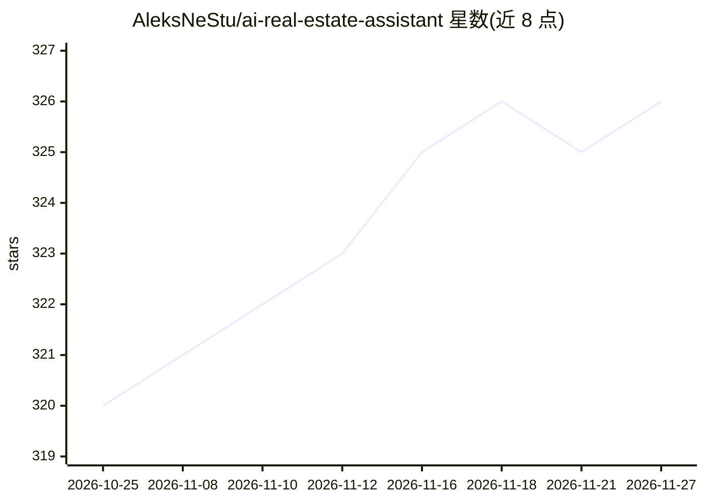

# AleksNeStu/ai-real-estate-assistant

⭐ 326 · Python · MIT · 推送 2026-11-26 · [GitHub](https://github.com/AleksNeStu/ai-real-estate-assistant) · [官网](https://realty.kittray.com) · 个人维护

**自托管 AI 房产搜索助手：自然语言问房源、算贷款与估值**

面向房产搜索的开源对话式助手：对自有房源目录建语义索引，接受自然语言查询（含自动过滤抽取），用 ChromaDB 做 RAG 混合检索并 MMR 重排；聊天背后挂贷款、租买对比、ROI、TCO、比较市场分析与多年估值预测等工具；界面支持 9 种语言，输出带 EU AI Act 合规标签。部署提供托管平台一键、自托管 Docker Compose、CI 部署与拉取 GHCR 镜像四条路径；自托管无需付费模型 key 即可回答。

## 筛选速览

| 维度 | 判定 | 备注 |
|---|---|---|
| AI 角色 | `ai-native` | 本体是模型或模型工具 |
| 许可风险 | `permissive` | MIT |
| 部署形态 | `self-host` | docker 或自建部署 |
| 模型依赖 | local-ok | 支持本地模型 |
| 硬件要求 | — | 无带数字的原话,不猜 |
| 安装摩擦 | `low` | 无编译、无系统依赖或容器化 |
| 成熟度 | — | 结构信号不足 |

## 能力要点

- 17 个 LLM provider 路由，含自动 fallback 链与按请求选择
- 混合 RAG + 向量检索：ChromaDB + MMR 重排，按查询复杂度分流
- 房产金融工具集：贷款、租买对比、ROI、TCO、CMA、估值预测
- 支持自托管 Docker Compose、Kubernetes 与托管平台一键部署

## 适用场景

- 在自己服务器上为自有房源目录搭建自然语言搜索
- 通过聊天向租客/买家提供贷款、ROI、估值等分析工具
- 上传自有文档建知识库并查询
- 按城市/街区做市场趋势分析

## 场景标签

`聊天机器人` `AI 助手` `RAG` `文档问答` · 领域:对话与助手

## 证据(README 行号)

> L7: An open-source conversational assistant for property search, financial analysis
> L190: |**Conversational search**|Natural-language queries with automatic filter extraction; hybrid semantic + keyword re
> L199: 1. **Multi-provider LLM routing** — `17` providers with an automatic fallback

## 星数曲线

2026-10-25 320 → 2026-11-27 326（+6）

---
*卡片 v1 · prompt 1.4 · 生成 2026-11-27 · 置信度 high · 依据 README sha `9e956b017cc8` · [字段定义](../../DATASET.md)*
