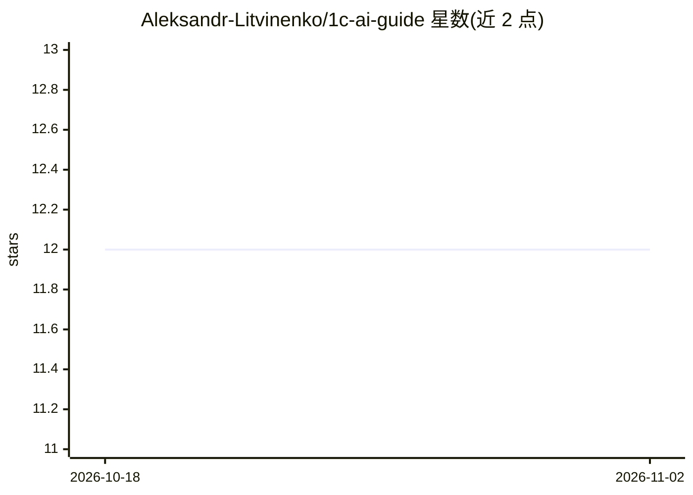

# Aleksandr-Litvinenko/1c-ai-guide

⭐ 12 · Python · MIT · 推送 2026-09-15 · [GitHub](https://github.com/Aleksandr-Litvinenko/1c-ai-guide) · 个人维护

**俄语指南：如何安全地把 AI 代理接入 1С 与 Bitrix24**

面向 1С 开发者、分析师、集成者与负责人的开放俄语指南：拆解四个已验证的接入场景（1С:Фреш OData 读写、Bitrix24 任务读取、网站表单创建线索、1С-Коннект+Jira+Bitrix24 三系统对账），并编目 14 个 1C/Bitrix24 相关 MCP 服务器与 Agent Skills 工具，每条标注验证级别（Docs/Artifact/CLI smoke/Live smoke）、许可证与关键风险。核心机制是安全分级：四步 внедрение 阶梯（源码→测试库→只读生产库→受控写入）、服务端权限限制、负面写入测试与 dry-run→preview→人工确认流程。配套脚本默认只读、隐藏敏感值，单元测试无需网络与真实密钥。

## 筛选速览

| 维度 | 判定 | 备注 |
|---|---|---|
| AI 角色 | `ai-knowledge` | 知识聚合/清单类 |
| 许可风险 | `permissive` | MIT |
| 部署形态 | `None` |  |
| 模型依赖 | — | README 未给出锁定关系 |
| 硬件要求 | — | 无带数字的原话,不猜 |
| 安装摩擦 | `low` | 无编译、无系统依赖或容器化 |
| 成熟度 | — | 结构信号不足 |

## 能力要点

- 四个拆解的接入场景，逐一标注已验证与未验证部分
- 14 个工具目录，含验证级别、许可证与风险边界，数据存于 catalog/tools.json
- 最小安全基线：服务端禁写、allowlist、负面测试、dry-run→preview→人工确认
- 四步 внедрение 阶梯：从源码副本到受控写入

## 适用场景

- 给 1С 或 Bitrix24 接 AI 代理前先弄清安全边界
- 为 1C BSL 代码库或配置选择合适的 MCP 服务器或 Agent Skills
- 搭建只读数据审计或三系统对账集成

## 场景标签

`精选清单` `教程课程` · 领域:学习与行业

## 证据(README 行号)

> L5: Открытый гайд на русском языке: MCP-серверы, Agent Skills, OData, REST API, входящие вебхуки, разграничение прав и п
> L21: |Выбрать MCP-сервер или Agent Skills под задачу|Выбор стека · каталог из 14 проектов|
> L131: 14 отобранных проектов. Столбец «Проверка» показывает, что сделано: `Docs` — изучены документация и заявления авто

## 星数曲线

2026-10-18 12 → 2026-11-02 12（+0）

---
*卡片 v1 · prompt 1.4 · 生成 2026-11-01 · 置信度 high · 依据 README sha `8ee81d67cb64` · [字段定义](../../DATASET.md)*
