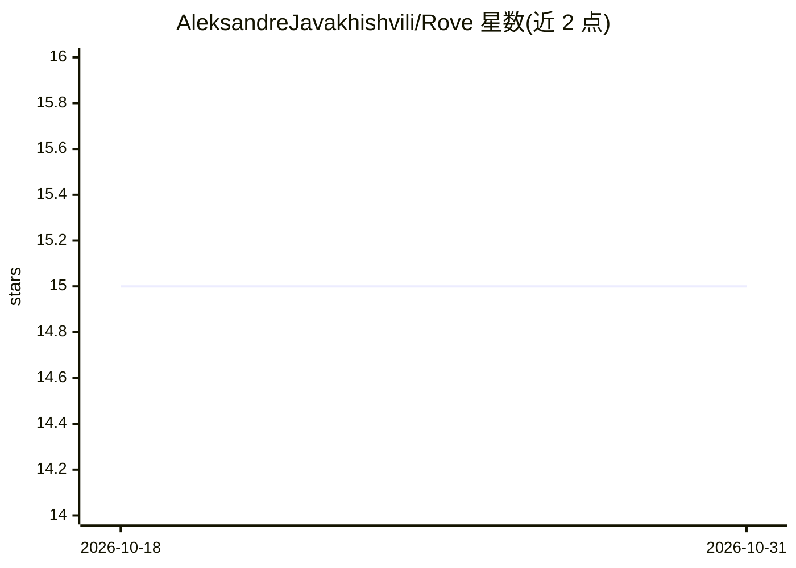

# AleksandreJavakhishvili/Rove

⭐ 15 · TypeScript · MIT · 推送 2026-06-22 · [GitHub](https://github.com/AleksandreJavakhishvili/Rove) · 个人维护

**自托管手机客户端：经 Tailscale 点对点远程控制本机 CLI 编程 agent**

两件自托管组件：桌面端 Node.js bridge（约3MB，无DB无守护进程）在桌面伴随 claude 运行，通过 @anthropic-ai/claude-agent-sdk 进程内驱动 Claude Code，经 HTTP+WebSocket 在 tailnet 上暴露会话；移动端为 Expo/React Native 应用或浏览器 web 客户端，读取会话历史、流式展示工具调用与 diff、弹出审批、内嵌 dev server 实时预览，多机 bridge 汇聚为单一收件箱。面向希望零第三方中转的开发者，密钥与会话文件不离开本机。目前端到端支持 Claude Code，Codex/Aider/Gemini 驱动已搭骨架未实现，API 可能变更。

## 筛选速览

| 维度 | 判定 | 备注 |
|---|---|---|
| AI 角色 | `ai-ecosystem` | LLM/agent 周边工具 |
| 许可风险 | `permissive` | MIT |
| 部署形态 | `library` | 以包/库形式分发 |
| 模型依赖 | locked-api |  |
| 硬件要求 | — | 无带数字的原话,不猜 |
| 安装摩擦 | `low` | 无编译、无系统依赖或容器化 |
| 成熟度 | `idea` | |

## 能力要点

- Tailscale 点对点传输，无云中继，代码与 API key 留在本机
- bridge 经 agent SDK 进程内驱动 Claude Code，审批经 canUseTool 直达手机
- 多机 bridge 聚合为单一收件箱，客户端侧聚合无中央服务器
- 手机端 WebView 实时预览 agent 正在编辑的 dev server

## 适用场景

- 在手机上远程查看并批准本机 Claude Code 会话的工具调用
- 出门时继续跟进多台机器上的编程 agent 会话
- 在自托管、不经第三方服务器的前提下移动操控编码 agent

## 场景标签

`编码 Agent` · 领域:编码与开发

## 证据(README 行号)

> L27: 1. A **bridge** — tiny Node.js server you run alongside `claude` on your desktop. Drives Claude Code in-process via
> L34: Existing mobile clients (Happy, etc.) work — but they route your turns through their own infrastructure, even with 
> L38: Early. Works end-to-end with Claude Code today, across as many machines as you run the bridge on; Codex / Aider / G

## 星数曲线

2026-10-18 15 → 2026-10-31 15（+0）

---
*卡片 v1 · prompt 1.4 · 生成 2026-10-31 · 置信度 mid · 依据 README sha `5f8b50cd62b3` · [字段定义](../../DATASET.md)*
