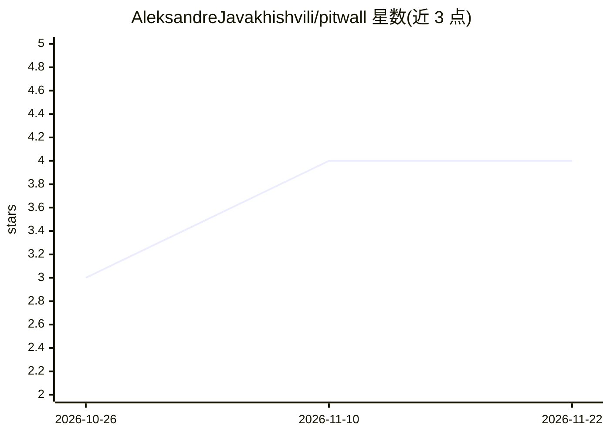

# AleksandreJavakhishvili/pitwall

⭐ 4 · Rust · Apache-2.0 · 推送 2026-11-19 · [GitHub](https://github.com/AleksandreJavakhishvili/pitwall) · [官网](https://aleksandrejavakhishvili.github.io/pitwall/) · 个人维护

**编排终端编码 Agent 的桌面管理器：一眼看出谁在等你**

一个 Rust 编写的桌面应用（GPUI，无 WebView），用于并行运行和监视 Claude Code、Codex 等 9 种终端编码 Agent CLI：侧栏状态标记（needs you 变琥珀色、Dock 徽章计数）、悬浮小窗远程应答、提示词队列（Next up）、按任务的 diff 评审（Review）、多账户与 worktree 支持。Agent 终端由独立的 pitwall-hold 进程持有，应用退出后会话继续存活并可回放滚动缓冲；附 pitwall CLI（JSON 输出）与远程 agw VM 会话管理，跨机/危险操作需人工审批。提供 macOS/Windows/Linux 安装包，均未代码签名，首次启动需手动放行。

## 筛选速览

| 维度 | 判定 | 备注 |
|---|---|---|
| AI 角色 | `ai-ecosystem` | LLM/agent 周边工具 |
| 许可风险 | `permissive` | Apache-2.0 |
| 部署形态 | `desktop` | 安装包/桌面程序 |
| 模型依赖 | — | README 未给出锁定关系 |
| 硬件要求 | — | 无带数字的原话,不猜 |
| 安装摩擦 | `medium` | 含编译或系统依赖之一 |
| 成熟度 | — | 结构信号不足 |

## 能力要点

- 9 种 Agent CLI 的状态检测（hooks + 屏幕匹配规则，可自定义 TOML 扩展）
- pitwall-hold 进程持有 PTY：关闭窗口后 Agent 继续运行，重启回放 scrollback
- Next up 队列与 Review diff 评审（行级评论回传为提示词）
- pitwall CLI 带调用方识别与审批机制，防止 Agent 自批

## 适用场景

- 同时跑多个编码 Agent，聚焦处理真正需要人工决策的那个
- 在其他应用中通过悬浮卡片批准/拒绝权限请求
- 对 Agent 改动逐行评审后再提交合并
- 在 agw VM 上远程启动和监视 Agent 会话

## 场景标签

`编码 Agent` `代码审查` · 领域:编码与开发

## 证据(README 行号)

> L6:  Run Claude Code, Codex and any other terminal coding agent side by side,
> L28: - **A tool, not an agent.** It never rewrites your prompts or decides what an agent does. Text you send goes in exa
> L92: Settings → *Install command-line tool* links `pitwall` into `~/.local/bin` or `/usr/local/bin`. It talks to the run

## 星数曲线

2026-10-26 3 → 2026-11-22 4（+1）

---
*卡片 v1 · prompt 1.4 · 生成 2026-11-21 · 置信度 high · 依据 README sha `2b715ae659f1` · [字段定义](../../DATASET.md)*
