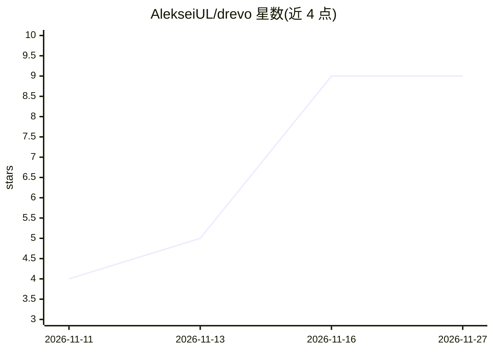

# AlekseiUL/drevo

⭐ 9 · JavaScript · MIT · 推送 2026-11-12 · [GitHub](https://github.com/AlekseiUL/drevo) · [官网](https://alekseiul.github.io/drevo/) · 个人维护

**家谱研究 AI agent 技能与工具集：家族口述到可溯源家谱**

为用户的 AI agent 提供的家谱研究本地资源包：研究技能（访谈、确定研究问题、历史地理、免费来源）、可视化技能、40 条免费检索路线与 8 条付费路线参考，以及证据卡片、人物档案、案件管理与树构建等本地 CLI 命令。检索由 agent 通过自身浏览器执行，本包不做检索。聚焦俄罗斯、前苏联与格鲁吉亚地区，输出 MIT 许可，v0.4 无 GEDCOM 解析与自动化抓包功能。

## 筛选速览

| 维度 | 判定 | 备注 |
|---|---|---|
| AI 角色 | `ai-knowledge` | 知识聚合/清单类 |
| 许可风险 | `permissive` | MIT |
| 部署形态 | `None` |  |
| 模型依赖 | — | README 未给出锁定关系 |
| 硬件要求 | — | 无带数字的原话,不猜 |
| 安装摩擦 | `low` | 无编译、无系统依赖或容器化 |
| 成熟度 | `idea` | |

## 能力要点

- 研究技能与可视化技能以 SKILL.md 形式供 agent 读取
- 40 条免费检索路线与单独标注的 8 条付费路线
- 证据卡片分离原始来源、读取、结论与矛盾，支持「为何此关系」溯源
- 本地 CLI：init/plan/audit/tree-preview/tree-apply/dossier 等命令

## 适用场景

- 整理家族口述与已知信息并生成研究计划
- 让 AI agent 按路线查找墓碑照片、军事档案、教堂登记册等来源
- 构建可发布到自有主机的静态家族树网站并收集亲属补充信息

## 场景标签

`科研工具` · 领域:学习与行业

## 证据(README 行号)

> L11: Это локальный набор навыков, инструментов и источников для вашего ИИ-агента. Веб-поиск выполняет агент через доступ
> L55: Откройте репозиторий в Codex или другом агенте, умеющем читать файлы, работать с браузером и сохранять результаты. 

## 星数曲线

2026-11-11 4 → 2026-11-27 9（+5）

---
*卡片 v1 · prompt 1.4 · 生成 2026-11-20 · 置信度 high · 依据 README sha `78679f3cc911` · [字段定义](../../DATASET.md)*
