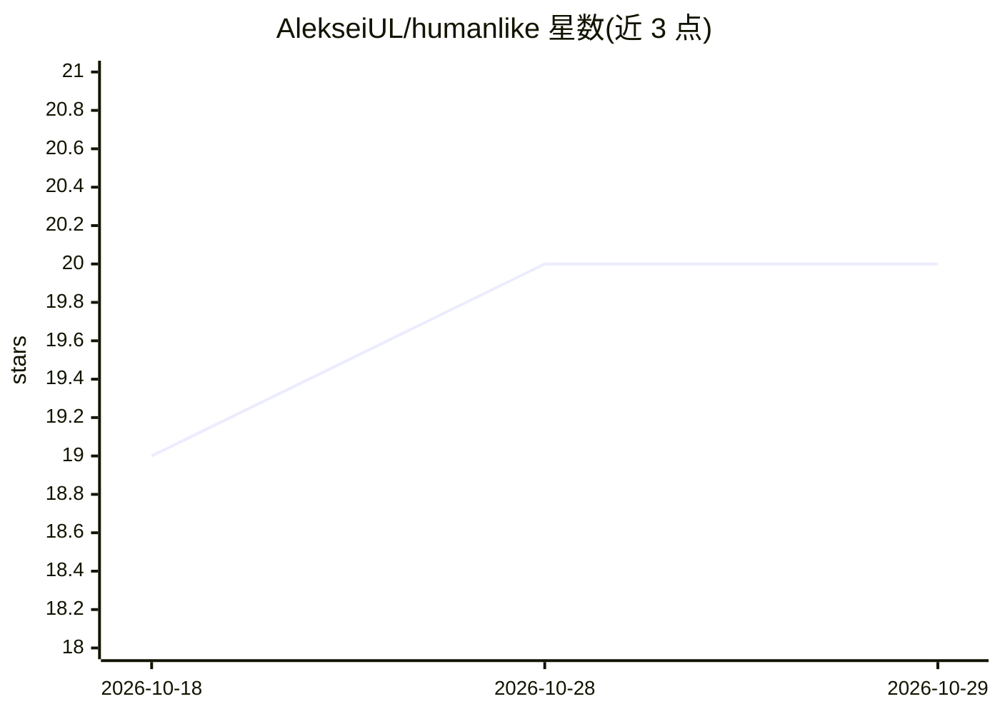

# AlekseiUL/humanlike

⭐ 20 · Python · MIT · 推送 2026-10-27 · [GitHub](https://github.com/AlekseiUL/humanlike) · 个人维护

**为对话式 AI 代理提供确定性人格与行为控制层**

面向 AI 代理宿主的 Python 行为规划库：对每个对话轮次做确定性分类与路由（RU/EN），选择社会与认知模式，组装有界的上下文计划并返回隐私感知元数据；模型调用、工具与交付仍由宿主负责。核心运行时离线、仅用 Python 标准库、不调用 LLM 与网络。提供可选的 SQLite 记忆（需宿主显式同意）、40 例离线一致性测试套件、Hermes 插件参考实现及 route/doctor/eval 三个 JSON CLI 命令。当前为 0.1.2 公测，SQLite 记忆在 0.1.x 仅限 POSIX。

## 筛选速览

| 维度 | 判定 | 备注 |
|---|---|---|
| AI 角色 | `ai-ecosystem` | LLM/agent 周边工具 |
| 许可风险 | `permissive` | MIT |
| 部署形态 | `library` | 以包/库形式分发 |
| 模型依赖 | — | README 未给出锁定关系 |
| 硬件要求 | — | 无带数字的原话,不猜 |
| 安装摩擦 | `low` | 无编译、无系统依赖或容器化 |
| 成熟度 | `idea` | |

## 能力要点

- 确定性 RU/EN 路由与认知/社会模式选择，不调用 LLM
- 人格锚定、重复控制、立场校准与漂移信号
- 可选 SQLite 记忆，需宿主显式同意启用
- 40 例离线一致性测试套件与 Hermes 插件参考实现

## 适用场景

- 为我的 AI 代理宿主加一层确定性的行为与人格控制
- 在不上线的离线环境运行行为一致性检查
- 通过 Hermes 插件钩子集成行为规划

## 场景标签

`Agent 框架` · 领域:Agent 开发

## 证据(README 行号)

> L22: Humanlike is a behavioral planning layer for AI agents. It classifies each turn, selects a social and cognitive mod
> L31: - A reference Hermes directory plugin with `pre_llm_call`, `transform_llm_output`, `post_llm_call`, and `on_session

## 星数曲线

2026-10-18 19 → 2026-10-29 20（+1）

---
*卡片 v1 · prompt 1.4 · 生成 2026-10-28 · 置信度 high · 依据 README sha `23f5ed305ffb` · [字段定义](../../DATASET.md)*
