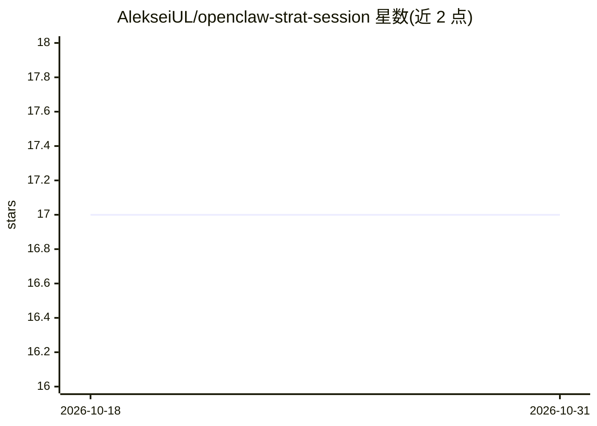

# AlekseiUL/openclaw-strat-session

⭐ 17 · Python · MIT · 推送 2026-10-29 · [GitHub](https://github.com/AlekseiUL/openclaw-strat-session) · [官网](https://t.me/Sprut_AI) · 个人维护

**供 agent 使用的战略会议主持技能，面向个人与团队**

以单个 SKILL.md 形式分发的 AI 技能：安装到 OpenClaw / ClaudeClaw 等 agent 的技能目录后，通过对话主持基于 EOS、OKR、4DX、Scaling Up 的战略会议。功能含业务入门问卷、Scorecard 指标追踪、季度 Rocks、Pre-mortem、5 Whys、7 类认知偏差监测等；首次运行自动识别单人或团队模式，结果可存入 Obsidian、Notion 或本地文件。无依赖，兼容任何支持 tool calling 的模型。

## 筛选速览

| 维度 | 判定 | 备注 |
|---|---|---|
| AI 角色 | `ai-native` | 本体是模型或模型工具 |
| 许可风险 | `permissive` | MIT |
| 部署形态 | `None` |  |
| 模型依赖 | — | README 未给出锁定关系 |
| 硬件要求 | — | 无带数字的原话,不猜 |
| 安装摩擦 | `low` | 无编译、无系统依赖或容器化 |
| 成熟度 | — | 结构信号不足 |

## 能力要点

- 综合 EOS/OKR/4DX/Scaling Up 四套框架的会议流程
- 首次运行自适应识别单人或团队模式（50 人以内）
- 监测 7 类认知偏差并提供 Pre-mortem、5 Whys 工具
- 零依赖，结果可存入 Obsidian/Notion/本地文件

## 适用场景

- 个人创业者按月度/季度节奏做战略复盘与目标设定
- 小团队用 AI 主持基于 OKR/Rocks 的季度规划会
- 借助认知偏差提示避免常见规划错误

## 场景标签

`AI 助手` · 领域:对话与助手

## 证据(README 行号)

> L28: AI skill that facilitates strategic sessions like a professional business coach:
> L127: - Any model with tool calling support (Claude, GPT-4, Gemini)

## 星数曲线

2026-10-18 17 → 2026-10-31 17（+0）

---
*卡片 v1 · prompt 1.4 · 生成 2026-10-30 · 置信度 high · 依据 README sha `cc525bb3b79a` · [字段定义](../../DATASET.md)*
