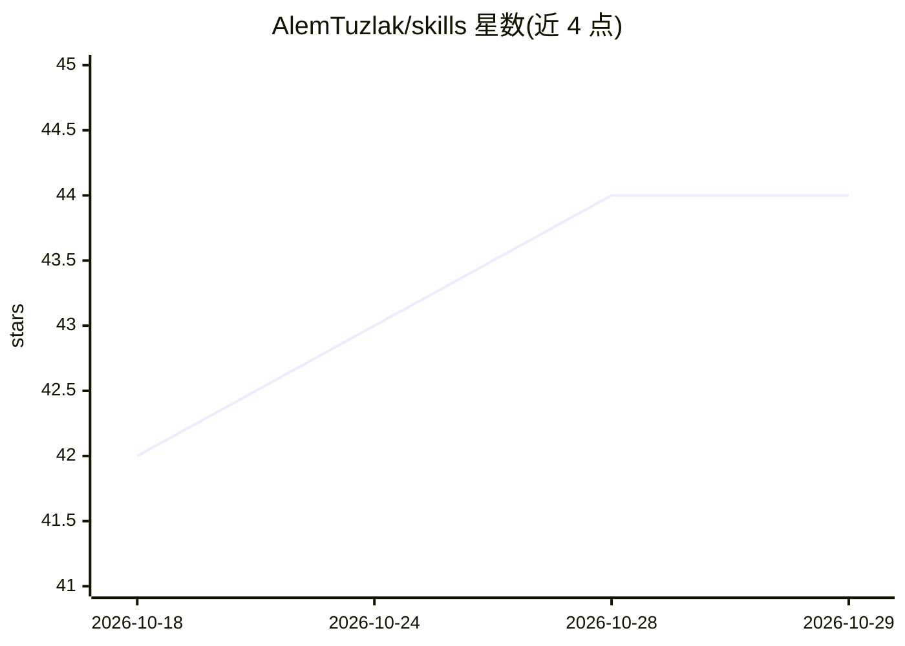

# AlemTuzlak/skills

⭐ 44 · JavaScript · 推送 2026-10-21 · [GitHub](https://github.com/AlemTuzlak/skills) · 个人维护

**个人 AI 编程 agent 技能集：把 PR/想法变成营销、演示与文档**

一套以 SKILL.md（YAML frontmatter）格式编写的个人 agent 技能库，面向 Claude Code、GitHub Copilot CLI、OpenAI Codex CLI、Gemini CLI、Cursor 与 Grok 等工具，放入各自 skills 目录即可使用。技能把 PR、git ref 或自由文本转化为营销简报、博客、changelog、社交文案、新闻邮件、视频脚本、Remotion/HyperFrames 渲染的 mp4、Slidev/Three.js 演示、文档、RFC、PRD 与课程；另含 8 个构建功能的 build pack 技能，由 /build-feature 编排。以 Claude Code 插件形式打包，但技能本身为纯文本文件。

## 筛选速览

| 维度 | 判定 | 备注 |
|---|---|---|
| AI 角色 | `ai-ecosystem` | LLM/agent 周边工具 |
| 许可风险 | `none` | — |
| 部署形态 | `None` |  |
| 模型依赖 | — | README 未给出锁定关系 |
| 硬件要求 | — | 无带数字的原话,不猜 |
| 安装摩擦 | `low` | 无编译、无系统依赖或容器化 |
| 成熟度 | — | 结构信号不足 |

## 能力要点

- 约 30 个 SKILL.md 技能：营销、changelog、演示、文档、RFC/PRD、课程生成等
- 输入多态：接受 PR URL、git ref 范围、文件路径或自由文本
- marketing-pipeline 一条命令串起简报→博客→社交→邮件→视频
- build pack 8 技能覆盖规划、复用、测试、调试与实现，/build-feature 为驱动

## 适用场景

- 发布新版本时一键生成 changelog、博客与社交文案
- 把 PR 转成面向管理层的架构影响文档或营销简报
- 让 agent 从一个主题生成渲染好的宣传视频或 Slidev 演示
- 在多个编码 agent 工具间复用同一套提示技能

## 场景标签

`AI 写作` `提示工程` · 领域:Agent 开发

## 证据(README 行号)

> L3: Personal Agent Skills I use across every project. They turn a PR, a git ref, or a freeform idea into marketing brief
> L7: Packaged as a Claude Code plugin, but the skills themselves are plain `SKILL.md` files with standard YAML frontmatte

## 星数曲线

2026-10-18 42 → 2026-10-29 44（+2）

---
*卡片 v1 · prompt 1.4 · 生成 2026-10-25 · 置信度 high · 依据 README sha `f4ad4f2246bd` · [字段定义](../../DATASET.md)*
