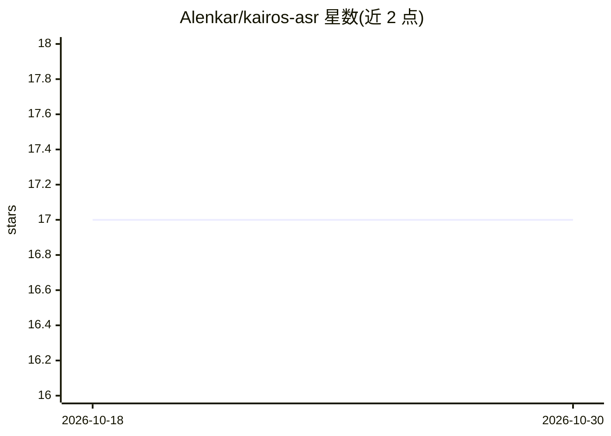

# Alenkar/kairos-asr

⭐ 17 · Python · MIT · 推送 2026-03-25 · [GitHub](https://github.com/Alenkar/kairos-asr) · 个人维护 · 中文 README

**俄语语音识别 Python/CLI 库：ONNX 推理的 GigaAM RNN-T 转写**

基于 GigaAM RNN-T 架构与 ONNX 的俄语语音转文本库，面向需要将 ASR 集成到微服务或桌面应用的开发者。提供 CPU、CUDA GPU、macOS Metal (MPS) 三种安装变体；内置 Silero VAD 将长音频切分为 15–25 秒分段处理，输出词级与句级时间戳；模型权重来自 GigaAM 项目，经 ONNX 转换与 Lora 微调，托管于 Hugging Face，首次运行需联网下载并要求 ffmpeg 在 PATH。以 pip 包、Python API 与 CLI 三种方式交付。

## 筛选速览

| 维度 | 判定 | 备注 |
|---|---|---|
| AI 角色 | `ai-native` | 本体是模型或模型工具 |
| 许可风险 | `permissive` | MIT |
| 部署形态 | `library` | 以包/库形式分发 |
| 模型依赖 | — | README 未给出锁定关系 |
| 硬件要求 | — | 无带数字的原话,不猜 |
| 安装摩擦 | `medium` | 含编译或系统依赖之一 |
| 成熟度 | — | 结构信号不足 |

## 能力要点

- GigaAM-style RNN-T + ONNX 推理，支持 CPU/CUDA/Metal
- 词级与句级时间戳输出
- 内置 Silero VAD 支持长音频分段处理
- 同时提供 Python API 与 CLI（transcribe/info 等命令）

## 适用场景

- 在服务或桌面应用中集成俄语语音转文本
- 为长录音生成分段转写并带时间戳
- 用 CLI 命令行批量转写音频文件

## 场景标签

`语音识别` · 领域:感知与多模态

## 证据(README 行号)

> L11: **Kairos ASR** — высокопроизводительная библиотека распознавания русской речи на базе
> L75: result = asr.transcribe(wav_file="audio.wav")

## 星数曲线

2026-10-18 17 → 2026-10-30 17（+0）

---
*卡片 v1 · prompt 1.4 · 生成 2026-10-30 · 置信度 high · 依据 README sha `9c128af53a82` · [字段定义](../../DATASET.md)*
