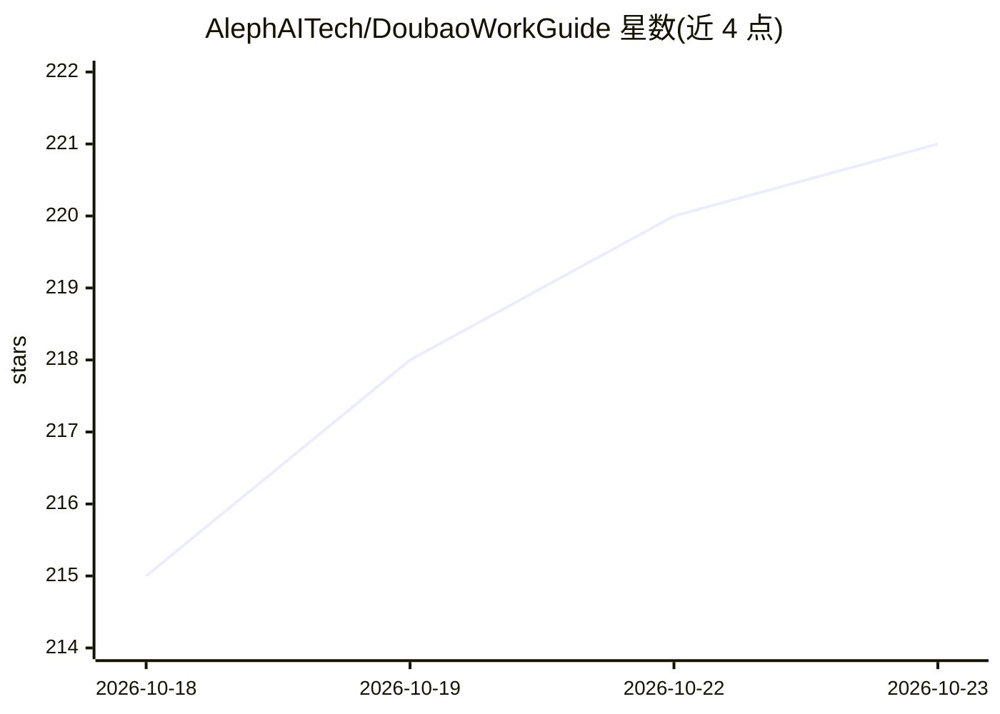

# AlephAITech/DoubaoWorkGuide

⭐ 221 · JavaScript · MIT · 推送 2026-10-19 · [GitHub](https://github.com/AlephAITech/DoubaoWorkGuide) · [官网](https://doubaowork.homes/) · 组织维护 · 中文 README

**豆包工作的中文实践指南网站：49 篇教程与 31 个真实任务**

面向豆包工作（DoubaoWork）用户的非官方系统化中文实践资料，覆盖安装登录、连接器、Skill、API、定时任务、多 Agent 工作流等核心能力，并按个人提效、自媒体、知识管理、电商、金融研究五类场景给出 31 个真实任务案例。内容与静态网站展示层分离，提供全文搜索、章节导航、阅读进度与移动端适配，站点由 Cloudflare 托管，本地运行仅需 python3 起 HTTP 服务。项目声明非官方，功能以产品当前版本为准。

## 筛选速览

| 维度 | 判定 | 备注 |
|---|---|---|
| AI 角色 | `ai-knowledge` | 知识聚合/清单类 |
| 许可风险 | `permissive` | MIT |
| 部署形态 | `library` | 以包/库形式分发 |
| 模型依赖 | — | README 未给出锁定关系 |
| 硬件要求 | — | 无带数字的原话,不猜 |
| 安装摩擦 | `low` | 无编译、无系统依赖或容器化 |
| 成熟度 | — | 结构信号不足 |

## 能力要点

- 49 篇指南与案例，31 个场景任务（五类工作场景）
- 内容数据与展示层分离，内容存于结构化 JSON
- 纯静态站点，本地运行仅需 python3 -m http.server
- 提供 npm test 与 npm run audit 的自动化验收流程

## 适用场景

- 第一次使用豆包工作时按路径从安装跑到首个可验收任务
- 按自媒体、电商、金融研究等场景查找相近任务案例
- 团队沉淀一次成功经验为可复用工作流时参考

## 场景标签

`教程课程` · 领域:学习与行业

## 证据(README 行号)

> L15: 豆包工作蓝皮书（DoubaoWork Guide）是一份面向豆包工作的系统化中文实践资料。项目为新用户提供从下载安装到完成首个可验收任务的完整上手路径，并继续覆盖连接器、Skill、API、定时任务、多 Agent 工作小队等核心
> L17: 基础能力之外，指南从个人提效、自媒体、知识管理、电商和金融研究五类工作场景出发，通过 31 个真实任务展示如何把材料、要求和工具组织为可检查、可交付、可复用的工作成果。

## 星数曲线

2026-10-18 215 → 2026-10-23 221（+6）

---
*卡片 v1 · prompt 1.4 · 生成 2026-10-22 · 置信度 mid · 依据 README sha `b00895472cc2` · [字段定义](../../DATASET.md)*
