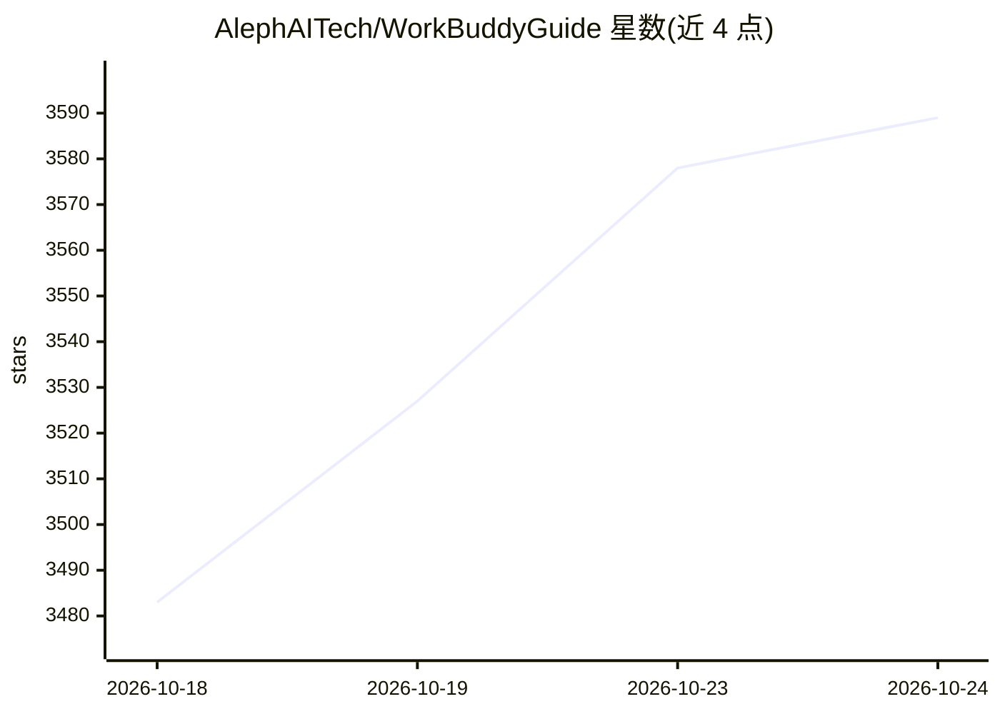

# AlephAITech/WorkBuddyGuide

⭐ 3,589 · TypeScript · MIT · 推送 2026-10-19 · [GitHub](https://github.com/AlephAITech/WorkBuddyGuide) · [官网](https://workbuddy.homes/) · 组织维护 · 中文 README

**社区维护的 WorkBuddy 实战教程与案例知识库**

以真实任务为主线的 WorkBuddy 使用读本，内容分四篇：使用手册（安装、界面、Skill、连接器、API 与自动化）、案例篇（办公、会议、投资、自媒体等场景）、进阶篇（Skill 开发、多 Agent 系统设计）、岗位行业路线与附录。配套社区案例集，可通过问卷提交场景需求，被采纳后制作成开源 Case。网站基于 VitePress 构建，本地运行需 Node.js 20~24，MIT 协议。声明为非官方项目，产品信息以官方渠道为准。

## 筛选速览

| 维度 | 判定 | 备注 |
|---|---|---|
| AI 角色 | `ai-knowledge` | 知识聚合/清单类 |
| 许可风险 | `permissive` | MIT |
| 部署形态 | `library` | 以包/库形式分发 |
| 模型依赖 | — | README 未给出锁定关系 |
| 硬件要求 | — | 无带数字的原话,不猜 |
| 安装摩擦 | `low` | 无编译、无系统依赖或容器化 |
| 成熟度 | — | 结构信号不足 |

## 能力要点

- 四篇结构：使用手册、案例篇、进阶篇、岗位与行业
- 社区案例集与 Case 投稿流程（模板 + PR 审核）
- 覆盖 Skill 开发、连接器、自动化与多 Agent 系统设计
- VitePress 构建，Cloudflare Pages 自动部署

## 适用场景

- 第一次使用 WorkBuddy 时按章节完成安装与首个任务
- 带着具体工作任务查找对应场景案例
- 为团队落地参考权限边界、验收标准与失败回退做法
- 提交自己的使用场景并获得开源 Case 沉淀

## 场景标签

`教程课程` · 领域:学习与行业

## 证据(README 行号)

> L16: > 这不是官方功能说明书的改写，而是一本以真实任务为主线的实战读本。先完成安装和第一项工作，再进入移动办公、知识管理、专业诊断、内容自动化和多 Agent 团队，最后把一次成功变成团队可复用的工作系统。
> L28: |第一篇 · 使用手册|下载、安装、界面、第一个任务、Skill、连接器、API 和自动化|
> L110: 本项目是社区维护的 WorkBuddy 实战知识库。涉及产品功能、界面、价格、可用范围和安全策略等时效性信息时，请以 WorkBuddy 官方渠道为准。

## 星数曲线

2026-10-18 3,483 → 2026-10-24 3,589（+106）

---
*卡片 v1 · prompt 1.4 · 生成 2026-10-20 · 置信度 high · 依据 README sha `38f05c3c0c3d` · [字段定义](../../DATASET.md)*
