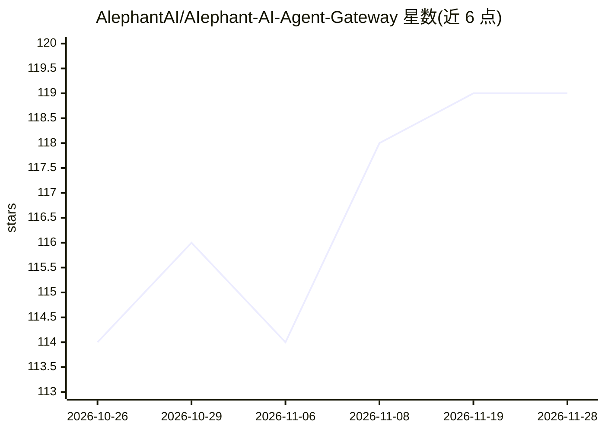

# AlephantAI/AIephant-AI-Agent-Gateway

⭐ 119 · Rust · GPL-3.0 · 推送 2026-11-05 · [GitHub](https://github.com/AlephantAI/AIephant-AI-Agent-Gateway) · [官网](https://openany.si) · 组织维护 · 中文 README

**为 AI 应用提供统一 OpenAI 兼容接口的自托管 LLM 网关**

Rust 编写的 OpenAI 兼容 AI 网关，覆盖 50+ 提供商、320+ 模型与自定义后端，提供请求适配、路由、重试/回退、策略控制、虚拟密钥、分层缓存与请求日志/审计。开发者一次接入即获得稳定 API 面；支持 Alephant Cloud 托管 SaaS 或自托管部署。自托管需 Rust 工具链与 PostgreSQL，Redis 推荐用于并发控制与缓存路径，Qdrant/S3 为可选语义缓存与正文归档。当前处于 beta（0.2.0-beta.30），API 与配置可能在 1.0 前变化。

## 筛选速览

| 维度 | 判定 | 备注 |
|---|---|---|
| AI 角色 | `ai-ecosystem` | LLM/agent 周边工具 |
| 许可风险 | `viral` | GPL-3.0 |
| 部署形态 | `None` |  |
| 模型依赖 | local-ok | 支持本地模型 |
| 硬件要求 | — | 无带数字的原话,不猜 |
| 安装摩擦 | `low` | 无编译、无系统依赖或容器化 |
| 成熟度 | `idea` | |

## 能力要点

- OpenAI 兼容 /v1/* 接口，50+ 提供商、320+ 模型统一接入
- 虚拟密钥、模型策略、提供商白名单与并发控制
- 网关侧 LLM KV 缓存与语义缓存，重试/回退/429 处理
- 数据库监听驱动的路由与密钥热更新，无需重启

## 适用场景

- 多个 AI 应用统一接入多家模型提供商，密钥集中管理
- 生产环境对 LLM 流量做策略、缓存与可观测性治理
- 在自有基础设施中自托管网关并保留上游密钥控制权

## 场景标签

`模型网关` `LLM 可观测性` · 领域:Agent 开发

## 证据(README 行号)

> L41: Alephant AI Gateway is an OpenAI-compatible control layer for production AI applications, available as hosted SaaS 
> L43: Instead of wiring every application directly to every provider, teams connect once and route across 50+ providers, 

## 星数曲线

2026-10-26 114 → 2026-11-28 119（+5）

---
*卡片 v1 · prompt 1.4 · 生成 2026-11-28 · 置信度 high · 依据 README sha `4fc4d26b44b7` · [字段定义](../../DATASET.md)*
