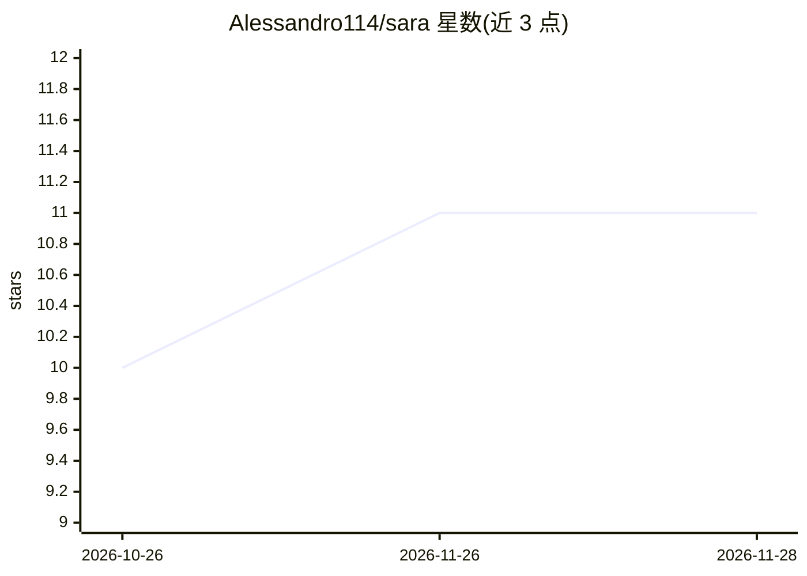

# Alessandro114/sara

⭐ 11 · TypeScript · AGPL-3.0 · 推送 2026-11-20 · [GitHub](https://github.com/Alessandro114/sara) · [官网](https://get-scala.com) · 个人维护

**面向企业的自托管 WhatsApp AI 客服 agent，含 20 行业垂直配置**

SARA 是可自托管的 WhatsApp AI agent，通过 WAHA 连接 WhatsApp，提供 function calling（87 个工具定义）、RAG 检索（PostgreSQL + pgvector + BM25 混合搜索）、PII 匿名化、提示注入防护与幻觉检测。内置 13 个行业 brain（餐厅、诊所、房产等 20 个垂直领域在开放 schema 中定义），支持意/英/西/葡多语言与 AI/人工/混合接管模式。Docker 部署，AGPL-3.0 许可，另提供云版本。

## 筛选速览

| 维度 | 判定 | 备注 |
|---|---|---|
| AI 角色 | `ai-native` | 本体是模型或模型工具 |
| 许可风险 | `viral` | AGPL-3.0 |
| 部署形态 | `self-host` | docker 或自建部署 |
| 模型依赖 | local-ok | 支持本地模型 |
| 硬件要求 | — | 无带数字的原话,不猜 |
| 安装摩擦 | `low` | 无编译、无系统依赖或容器化 |
| 成熟度 | — | 结构信号不足 |

## 能力要点

- 多供应商 LLM 链（Groq → Cerebras → SambaNova → Mistral）自动故障转移
- RAG 混合检索：pgvector 1024d 嵌入 + BM25 关键词回退
- 87 个工具定义覆盖 20 个行业垂直，支持 function calling
- 每次外部 LLM 调用前进行 PII 匿名化与提示注入防护

## 适用场景

- 餐厅用 WhatsApp bot 处理订位与过敏原查询
- 诊所通过 WhatsApp 安排患者预约与接诊表单
- 需要自托管且无供应商锁定的企业客服自动化
- 为垂直行业接入自己的知识库与业务工具

## 场景标签

`聊天机器人` · 领域:对话与助手

## 证据(README 行号)

> L10: **SARA is a self-hostable AI agent for WhatsApp that understands your industry. 13 industry brains included in this
> L18: - **vs Generic chatbots (Tidio, Landbot):** SARA knows your industry. A restaurant bot books tables and checks alle

## 星数曲线

2026-10-26 10 → 2026-11-28 11（+1）

---
*卡片 v1 · prompt 1.4 · 生成 2026-11-20 · 置信度 high · 依据 README sha `369a48727d3c` · [字段定义](../../DATASET.md)*
