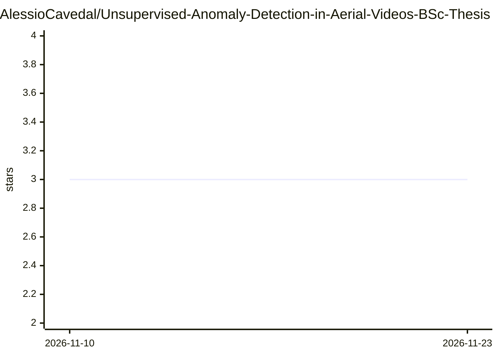

# AlessioCavedal/Unsupervised-Anomaly-Detection-in-Aerial-Videos-BSc-Thesis

⭐ 3 · NOASSERTION · 推送 2026-10-25 · [GitHub](https://github.com/AlessioCavedal/Unsupervised-Anomaly-Detection-in-Aerial-Videos-BSc-Thesis) · 个人维护

**无人机视频无监督异常检测的 BSc 学位论文（罗马第一大学）**

罗马第一大学计算机科学本科毕业论文项目页：用卷积自编码器对无人机视频做无监督异常检测，仅用正常帧训练，重建误差作为异常分数。核心发现是该域内重建误差主要跟随帧对比度而非异常，提出按帧 z-score 归一化修正，在不重训练的情况下将单一全局模型的 AUC 从 58.4 提升到 65.3；并给出对比度权衡判据、2D/3D 模型分场景对比、Otsu 阈值告警决策链与 UCSD Ped2 对照实验。PyTorch 实现需另行索取，论文全文为意大利语 PDF。

## 筛选速览

| 维度 | 判定 | 备注 |
|---|---|---|
| AI 角色 | `ai-knowledge` | 知识聚合/清单类 |
| 许可风险 | `none` | NOASSERTION |
| 部署形态 | `None` |  |
| 模型依赖 | — | README 未给出锁定关系 |
| 硬件要求 | — | 无带数字的原话,不猜 |
| 安装摩擦 | `low` | 无编译、无系统依赖或容器化 |
| 成熟度 | — | 结构信号不足 |

## 能力要点

- 提出按帧 z-score 修正重建误差：分数空间归一化无需重训练，AUC 提升 6-7 点
- 给出 AUC σ 判据，预测对比度修正在哪些视频上有害
- 2D 单帧与 3D 六帧片段模型的七场景逐一对比
- 固定决策链（滑动中位数+Otsu 阈值）检出 26 个异常事件中的 22 个

## 适用场景

- 无人机巡检视频（公路/铁路/农田/光伏板）中定位值得人工查看的片段
- 研究重建误差在异常检测中的混淆因素与修正方法
- 在 Drone-Anomaly 基准上复现对比同协议下的结果

## 场景标签

 · 领域:计算机视觉/科研

## 证据(README 行号)

> L3: **BSc Thesis in Computer Science** · Sapienza University of Rome · Academic Year 2025/2026
> L185: The PyTorch implementation is available on request.

## 星数曲线

2026-11-10 3 → 2026-11-23 3（+0）

---
*卡片 v1 · prompt 1.4 · 生成 2026-11-22 · 置信度 high · 依据 README sha `c450bc855aec` · [字段定义](../../DATASET.md)*
