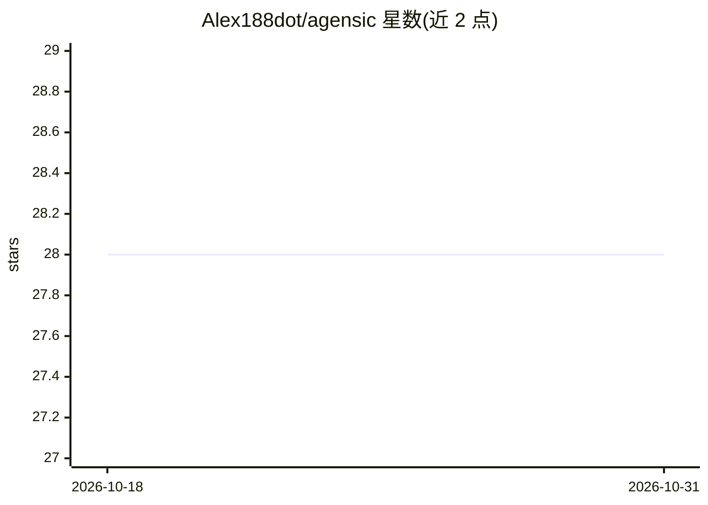

# Alex188dot/agensic

⭐ 28 · Python · Apache-2.0 · 推送 2026-08-09 · [GitHub](https://github.com/Alex188dot/agensic) · [官网](https://alex188dot.github.io/agensic/) · 个人维护

**面向 AI 终端工作流的命令观测与溯源层**

运行于 shell 环境的终端命令追踪框架，面向使用 AI 编码代理的开发者。功能分三块：Provenance 用本地 Ed25519 签名为每条命令打溯源标签（区分人输入、AI 执行、AI 建议人执行等 7 类）；Sessions 记录代理会话并支持回放与 Git Time Travel 回滚仓库状态；Autocomplete 提供基于本地历史的 IDE 式 Tab 补全，可配置本地或托管 LLM 作为按需回退，也支持纯离线历史模式。状态存于本地 SQLite，支持 macOS(Zsh) 与 Linux(Bash)，通过一键脚本或源码脚本安装。

## 筛选速览

| 维度 | 判定 | 备注 |
|---|---|---|
| AI 角色 | `ai-ecosystem` | LLM/agent 周边工具 |
| 许可风险 | `permissive` | Apache-2.0 |
| 部署形态 | `None` |  |
| 模型依赖 | local-ok | 支持本地模型 |
| 硬件要求 | — | 无带数字的原话,不猜 |
| 安装摩擦 | `low` | 无编译、无系统依赖或容器化 |
| 成熟度 | — | 结构信号不足 |

## 能力要点

- Ed25519 签名溯源标签，区分人输入/AI 执行/AI 建议
- 会话回放与 Git Time Travel 检查点回滚（恢复到新分支）
- 本地历史优先的 Tab 补全，LLM 仅作按需回退，可纯离线运行
- 预配置支持 21 种 AI 编码代理，可添加任意自定义代理

## 适用场景

- 审计 AI 代理在终端里执行过哪些命令、由谁触发
- 事故复盘时回放代理会话并导出 JSON/CSV 证据
- 在不记精确语法的情况下用自然语言生成 shell 命令

## 场景标签

`LLM 可观测性` `代码生成` · 领域:编码与开发

## 证据(README 行号)

> L5:  The missing observability layer for AI-powered terminal workflows
> L16: Agensic treats **terminal commands as first-class citizens** and provides a robust framework for tracking, inspecti
> L120: Stop guessing whether a human or an AI broke the build. Agensic captures rich metadata for every command and uses 

## 星数曲线

2026-10-18 28 → 2026-10-31 28（+0）

---
*卡片 v1 · prompt 1.4 · 生成 2026-10-26 · 置信度 high · 依据 README sha `f91f1cb4018f` · [字段定义](../../DATASET.md)*
