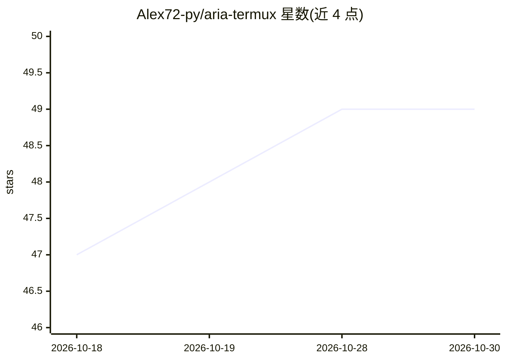

# Alex72-py/aria-termux

⭐ 49 · Python · MIT · 推送 2026-10-14 · [GitHub](https://github.com/Alex72-py/aria-termux) · [官网](https://dev.to/alex72py/i-built-aria-an-ai-terminal-co-pilot-for-termux-using-gemma-4-be4) · 个人维护

**Termux/Android 终端 AI 助手：问答、报错诊断与自动修复**

面向 Termux 终端的 Python AI 助手，针对 Android 文件系统、proot 容器、clang 编译器等手机开发环境特性提供问答、错误诊断与安装修复建议。通过斜杠命令交互，支持 Google AI Studio、OpenRouter、NVIDIA NIM 三个 provider 并可运行中切换；附带离线知识库检索、监控其他会话失败命令的 watch 模式，以及按风险分级确认危险命令的 Guardian 机制。仅依赖 rich 一个包，其余用标准库，HTTP 走 urllib。个人维护，为 Google Gemma 4 Challenge 起源项目，Linux 上可运行但非重点。

## 筛选速览

| 维度 | 判定 | 备注 |
|---|---|---|
| AI 角色 | `ai-native` | 本体是模型或模型工具 |
| 许可风险 | `permissive` | MIT |
| 部署形态 | `library` | 以包/库形式分发 |
| 模型依赖 | locked-api |  |
| 硬件要求 | — | 无带数字的原话,不猜 |
| 安装摩擦 | `low` | 无编译、无系统依赖或容器化 |
| 成熟度 | — | 结构信号不足 |

## 能力要点

- 三个 provider（Google AI Studio/OpenRouter/NVIDIA NIM）支持运行中切换与自动发现模型
- Guardian 按四级风险评分对危险命令分级确认
- watch 模式经 shell hook 记录其他 Termux 会话的失败命令供 /fix 诊断
- 仅依赖 rich，HTTP 用 stdlib urllib，无重框架

## 适用场景

- 在手机 Termux 上开发时直接提问或诊断报错
- 让 AI 建议修复损坏的安装并按风险分级确认执行
- 离线查阅知识库、在线切换模型与 provider

## 场景标签

`AI 助手` · 领域:对话与助手

## 证据(README 行号)

> L17: ARIA is an AI assistant that lives in your terminal. It knows about Termux, Android filesystem quirks, proot contai
> L19: It can answer questions, diagnose errors, suggest fixes, and auto-repair broken installs, all from a slash-command 

## 星数曲线

2026-10-18 47 → 2026-10-30 49（+2）

---
*卡片 v1 · prompt 1.4 · 生成 2026-10-25 · 置信度 mid · 依据 README sha `0c10d0041545` · [字段定义](../../DATASET.md)*
