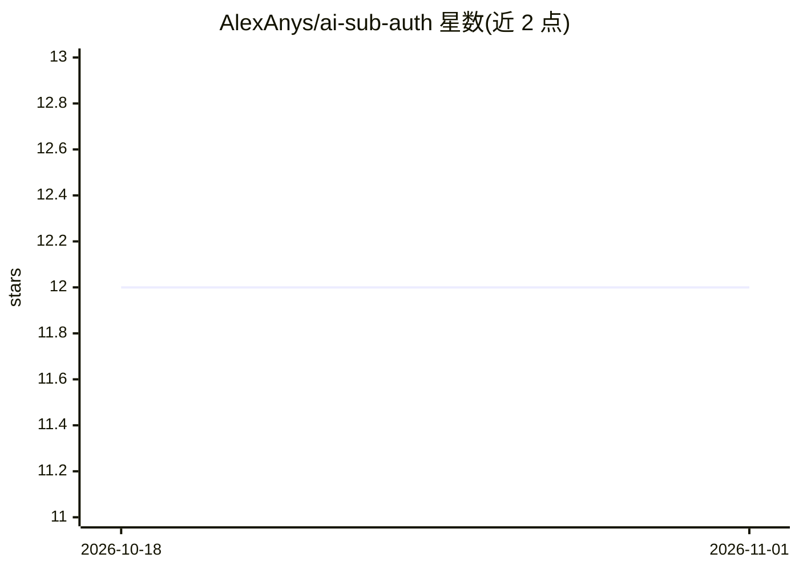

# AlexAnys/ai-sub-auth

⭐ 12 · Python · MIT · 推送 2026-02-28 · [GitHub](https://github.com/AlexAnys/ai-sub-auth) · 个人维护 · 中文 README

**复用现有 AI 订阅的轻量 Python 认证模块（7 个 provider）**

约 600 行、仅依赖 httpx 的 Python 库，把已有的 AI 订阅与 API key 桥接进应用：面向开发者提供自动检测、OAuth PKCE 登录、token 存储与自动刷新（文件锁、0600 权限）、统一 API；面向 AI agent 提供代码+知识参考（AGENT.md、8 个元技能、3 建议协议）。README 明确标注订阅复用现状：ChatGPT Plus/Pro 经 Codex OAuth 可复用，Claude/Gemini/DeepSeek/OpenRouter 仅 API key，Copilot 设备码可用但违反 ToS。

## 筛选速览

| 维度 | 判定 | 备注 |
|---|---|---|
| AI 角色 | `ai-ecosystem` | LLM/agent 周边工具 |
| 许可风险 | `permissive` | MIT |
| 部署形态 | `library` | 以包/库形式分发 |
| 模型依赖 | locked-api |  |
| 硬件要求 | — | 无带数字的原话,不猜 |
| 安装摩擦 | `low` | 无编译、无系统依赖或容器化 |
| 成熟度 | — | 结构信号不足 |

## 能力要点

- OAuth PKCE 流程自动登录 ChatGPT Plus/Pro 并复用订阅
- 7 个 provider 的统一 API 与凭证自动检测
- token 存储带 0600 权限、文件锁与自动刷新，自动导入 Codex CLI 旧 token
- 附 Agent 技能框架：8 个元技能与 SCAN→MATCH→RANK 建议协议

## 适用场景

- 在自建应用中复用已付费的 ChatGPT 订阅而无需 API 计费
- 统一管理多家 LLM provider 的 OAuth/API key 认证
- 让 AI agent 按元技能框架自动为应用提出 AI 集成方案

## 场景标签

`模型网关` · 领域:Agent 开发

## 证据(README 行号)

> L11: 1. **For developers** — Drop-in AI subscription auth with auto-detection, OAuth PKCE, token management, and a unifi
> L122: │  Your App    │────▶│  ai-sub-auth     │────▶│  Provider API   │
> L9: `ai-sub-auth` is a lightweight Python module (~600 lines, only depends on `httpx`) that bridges your existing AI sub

## 星数曲线

2026-10-18 12 → 2026-11-01 12（+0）

---
*卡片 v1 · prompt 1.4 · 生成 2026-11-01 · 置信度 mid · 依据 README sha `10968bb527ec` · [字段定义](../../DATASET.md)*
