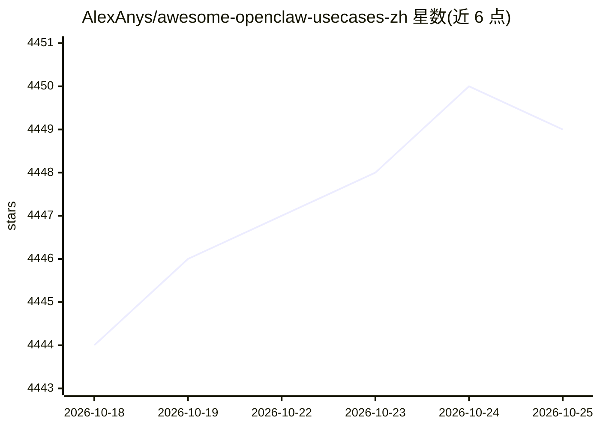

# AlexAnys/awesome-openclaw-usecases-zh

⭐ 4,448 · MIT · 推送 2026-07-12 · [GitHub](https://github.com/AlexAnys/awesome-openclaw-usecases-zh) · [官网](https://github.com/AlexAnys/awesome-openclaw-usecases-zh#readme) · 个人维护 · 中文 README

**面向中文用户的 OpenClaw 50 个真实使用案例合集**

OpenClaw（开源个人 AI 智能体）的中文用例策展仓库：收录 50 个按场景组织的用例，含 23 个国内生态用例（飞书/钉钉/企业微信/小红书/A 股监控等）与通用场景（生产力/研究/DevOps/金融）。每个用例按痛点、功能、所需技能、配置步骤、建议的统一格式编写，附可复制提示词与难度分级。另提供 AGENTS.md 执行协议与 INDEX.md 索引，供 OpenClaw/Claude Code/Codex/Hermes 等 AI 智能体按协议复现用例。受 awesome-openclaw-usecases 启发并独立发展。

## 筛选速览

| 维度 | 判定 | 备注 |
|---|---|---|
| AI 角色 | `ai-knowledge` | 知识聚合/清单类 |
| 许可风险 | `permissive` | MIT |
| 部署形态 | `None` |  |
| 模型依赖 | — | README 未给出锁定关系 |
| 硬件要求 | — | 无带数字的原话,不猜 |
| 安装摩擦 | `low` | 无编译、无系统依赖或容器化 |
| 成熟度 | — | 结构信号不足 |

## 能力要点

- 50 个用例分 11 类组织，含 23 个国内生态用例
- 统一格式（痛点/功能/技能/配置/建议）+ 可复制提示词 + 难度分级
- AGENTS.md 执行协议与 CONCEPT-MAPPING.md 供跨 agent 复现
- 国内平台适配：飞书、钉钉、企业微信、小红书、AKShare 等

## 适用场景

- 找现成方案把 AI 智能体接入飞书/钉钉等国内平台
- 照用例步骤搭建内容创作、行情监控、会议纪要等自动化流程
- 把用例交给 AI 智能体按 AGENTS.md 协议辅助执行

## 场景标签

`精选清单` · 领域:学习与行业

## 证据(README 行号)

> L19: > 一份面向中文用户的 OpenClaw 真实使用案例合集，包含社区验证的国际用例的中国适配，国内生态特色用例，从零入门。
> L33: - 新手入门指南

## 星数曲线

2026-10-18 4,444 → 2026-10-25 4,449（+5）

---
*卡片 v1 · prompt 1.4 · 生成 2026-10-20 · 置信度 high · 依据 README sha `865dab7f91e3` · [字段定义](../../DATASET.md)*
