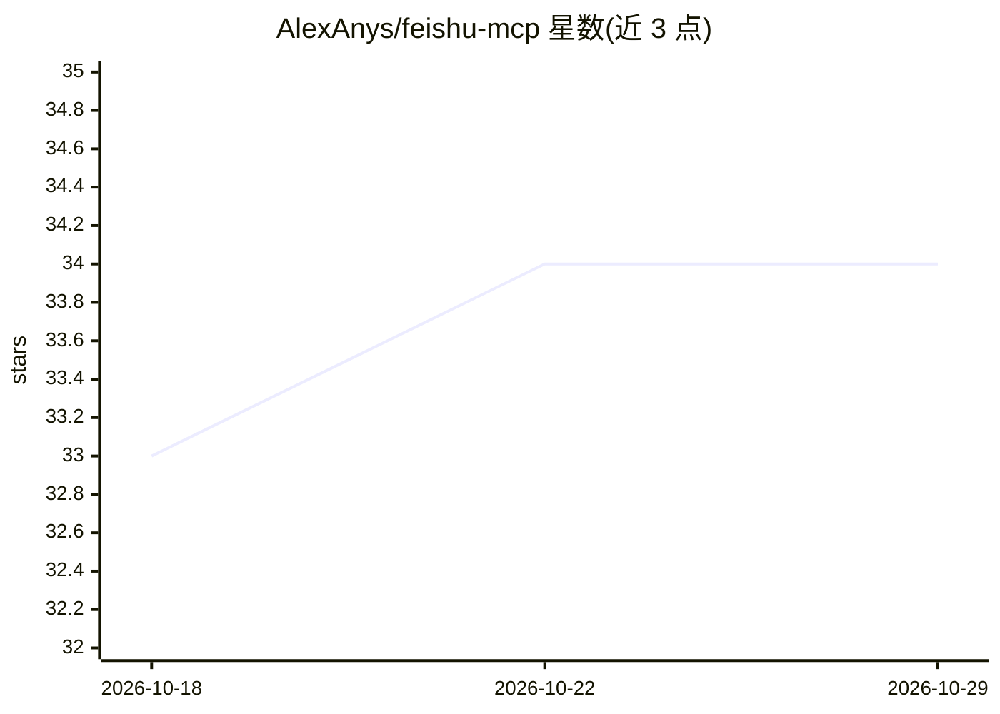

# AlexAnys/feishu-mcp

⭐ 34 · Shell · MIT · 推送 2026-03-31 · [GitHub](https://github.com/AlexAnys/feishu-mcp) · 个人维护 · 中文 README

**让 AI 助手读写飞书文档/表格/知识库的 MCP 配置与集成指南**

面向 Moltbot/Clawdbot、Cursor、Claude Desktop、Windsurf 等工具用户的飞书 MCP 集成方案：整合社区版 feishu-mcp（文档创建/编辑、Mermaid 图表、图片）与官方 lark-openapi-mcp（多维表格、日历、消息、搜索）两个 MCP 服务，提供一键配置脚本与手动配置步骤。使用前需在飞书开放平台创建自建应用并开通读写文档、云空间、知识库等权限，支持 tenant/user 两种认证。README 同时给出飞书官方 Lark CLI 的对比与共存建议。

## 筛选速览

| 维度 | 判定 | 备注 |
|---|---|---|
| AI 角色 | `ai-ecosystem` | LLM/agent 周边工具 |
| 许可风险 | `permissive` | MIT |
| 部署形态 | `library` | 以包/库形式分发 |
| 模型依赖 | — | README 未给出锁定关系 |
| 硬件要求 | — | 无带数字的原话,不猜 |
| 安装摩擦 | `low` | 无编译、无系统依赖或容器化 |
| 成熟度 | — | 结构信号不足 |

## 能力要点

- 整合 feishu-mcp 与 lark-openapi-mcp 两个 MCP 服务
- 一键配置脚本自动完成 App ID/Secret 配置
- 覆盖文档块级编辑、多维表格读写、知识库搜索、画板读取等约 25 个工具
- 支持 tenant/user 两种认证方式

## 适用场景

- 让 AI 助手直接创建和编辑飞书文档、插入 Mermaid 图表
- 通过对话读写多维表格做项目跟踪
- 在 Wiki 知识库中搜索、创建页面

## 场景标签

 · 领域:办公协作/AI 集成

## 证据(README 行号)

> L3: 飞书全能 MCP — 让 AI 助手完整操作你的飞书：创建文档、编辑内容、插入图表、管理表格。
> L5: 专为 **Moltbot/Clawdbot** 用户设计，也适用于 Cursor、Claude Desktop、Windsurf 等 AI 工具。
> L84: 本 Skill 整合了两个 MCP，发挥各自优势：

## 星数曲线

2026-10-18 33 → 2026-10-29 34（+1）

---
*卡片 v1 · prompt 1.4 · 生成 2026-10-25 · 置信度 low · 依据 README sha `f306c5d63e80` · [字段定义](../../DATASET.md)*
